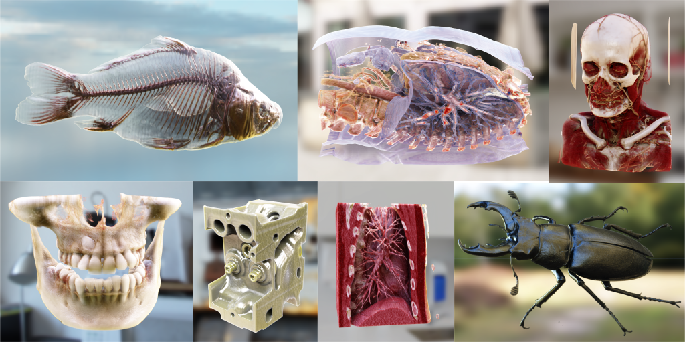

Crystal is a research platform for medical 3D visualization. It combines volume rendering and label-based material editing with visualization tools for reconstructed 3D scenes.

<CardGrid>
<LinkCard title="Volume data library" href="/medical-vis/Development_Manual/Datasets.html" description="Search the INFORAW collection by specimen and follow the original data sources." />
<LinkCard title="3D Gaussian splatting" href="/#gaussian-viewer" description="Explore Gaussian splatting scenes in the browser." />
</CardGrid>

## Rendering and analysis

- **Physically based volume rendering** maps voxel intensities to optical properties for visualizing tissue and material structure.
- **Mask channels and transfer functions** provide separate material controls for intensity values and discrete segmentation labels.
- **Gaussian workflows** support rendering data preparation, reconstruction tooling and a standalone viewer.

## Data and scenes

Crystal reads self-describing **INFORAW** volumes. Each file contains a readable metadata header and a compressed voxel payload. The header records the grid, storage type and spacing unit and can carry specimen provenance. Scene presets use XML or JSON to configure volume sources, rendering, cameras and lighting. Scene assets can refer to bundled examples, use absolute paths or live beside the scene file.

The [volume data library](../Development_Manual/Datasets.md) covers natural specimen CT, fossils and reference scans. The [external resources directory](../Development_Manual/Data_Resources.md) lists medical imaging repositories, HDR environments and mesh datasets.

## Research and source code

- [Realistic volume rendering](../Research_Field/Realistic_Rendering.md)
- [Medical image analysis](../Research_Field/Image_Analysis.md)
- [Geometry processing](../Research_Field/Geometry_Process.md)
- [Development instructions](../Development_Manual/Build_Crystal_Project.md)
- [CrystalVis source on GitHub](https://github.com/ai-crystal/CrystalVis)
