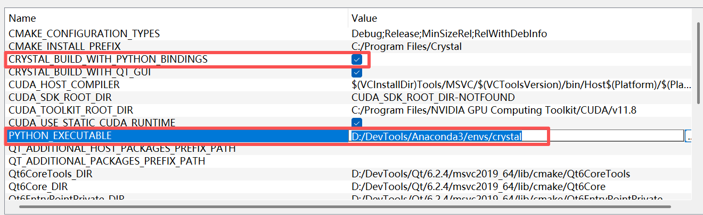
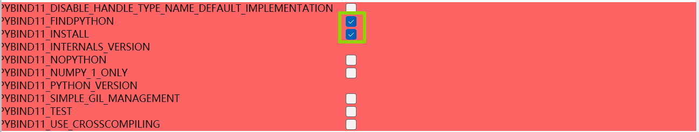
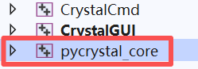

# Build Crystal Project

[Documentation](./Documentation.md) · [Code Structure](./Code_Structure.md) · [Software Operation](./Software_Operation.md)

## Tools and output layout

Use CMake **3.24 or newer**, an x64 Visual Studio C++ toolchain compatible with the CUDA Toolkit and Qt build, a CUDA Toolkit, and Qt 6 for the desktop GUI. Enable the Visual Studio **Desktop development with C++** workload. Use the Python interpreter and development libraries from the same environment if you build `pycrystal`. See the [Visual Studio downloads](https://visualstudio.microsoft.com/zh-hans/vs/older-downloads/), [CUDA Toolkit archive](https://developer.nvidia.com/cuda-toolkit-archive), [Qt downloads](https://www.qt.io/download-dev#eval-form) and [Anaconda downloads](https://www.anaconda.com/download).

| Location | Contents |
| --- | --- |
| `Crystal/` | Source, tracked resources and build definitions |
| `Crystal-Build/Build/` | CMake cache, solution, object files, tests and generated Help resources |
| `Crystal-Build/Release/` | Release executables, CUDA and Qt runtime, `Resources/`, `plugins/` and optional `Scripts/` |

Keep the executable and its runtime dependencies together. CMake enforces the sibling build layout.

## Configure and build on Windows

Run from the source checkout. The example uses a Visual Studio 2019 generator and a matching Qt kit. Substitute your locally installed generator, kit and GPU compute architecture where appropriate.

```powershell
$build = "../Crystal-Build/Build"
$qt = "D:/DevTools/Qt-VS2019/6.5.3/msvc2019_64"

cmake -S . -B $build -G "Visual Studio 16 2019" -A x64 `
  "-DCMAKE_PREFIX_PATH=$qt" `
  -DCRYSTAL_BUILD_WITH_QT_GUI=ON `
  -DCRYSTAL_BUILD_CMD=ON `
  -DCRYSTAL_BUILD_RENDER_PLUGINS=ON `
  -DCRYSTAL_CUDA_ARCHITECTURES=89 -DBUILD_TESTING=ON

cmake --build $build --config Release --parallel
```

Architecture `89` is an example for a matching NVIDIA GPU. Review `CRYSTAL_CUDA_ARCHITECTURES` before configuring for other hardware. Set generator and toolchain before the first configure for a build directory. For the plugin ABI contract without CUDA or Qt, configure a subdirectory under `Crystal-Build/Build` with `-DCRYSTAL_BUILD_PLUGIN_SDK_ONLY=ON` and run its CTest targets.

Open `../Crystal-Build/Release/Crystal.exe` and follow the [Engine-KM smoke test](./Software_Operation.md#example-1-render-engine-km). Close a running instance before rebuilding the same executable on Windows.

## How to build Crystal with Python support

Use the same interpreter at configure time and at import time. The module suffix encodes the Python ABI. Build the `pycrystal_core` target after enabling the option, then find the extension and the `pycrystal` package together under `Release/Scripts`.

```powershell
$python = (Get-Command python).Source
cmake -S . -B $build -DCRYSTAL_BUILD_WITH_PYTHON_BINDINGS=ON "-DPYTHON_EXECUTABLE=$python"
cmake --build $build --config Release --target pycrystal_core
$env:PYTHONPATH = (Resolve-Path "../Crystal-Build/Release/Scripts").Path
& $python -B -c "import pycrystal; print(pycrystal.__file__)"
```

## Run without the GUI

### Render a JSON scene with CrystalCmd

Choose an existing Crystal scene saved as JSON. Use absolute paths for both the scene and the image, and create the image’s parent directory first.

```powershell
$release = (Resolve-Path "../Crystal-Build/Release").Path
& "$release/CrystalCmd.exe" --list-renderers
& "$release/CrystalCmd.exe" --render "D:/VolumeProjects/specimen/scene.json" `
  "D:/VolumeProjects/specimen/render.png"
```

To test a loaded renderer module, use `--render-plugin <plugin.dll> <scene.json> <output.png>`. Use the module built for the same runtime and check the [plugin lifecycle](./Code_Structure.md#render-plugin-lifecycle).

### Render a synthetic array with Python

Run with the ABI-matched interpreter from the previous step. Install NumPy in that same environment. This small example uses a cubic feature and tests the renderer without a dataset download. The array axes are ZYX and spacing is supplied as XYZ.

```python
from pathlib import Path

import numpy as np
import pycrystal as pc

volume = np.zeros((48, 48, 48), dtype=np.uint16)
volume[12:36, 12:36, 12:36] = 2000
output = Path("D:/Develop/Crystal/Crystal-Build/Build/python-example.png")

with pc.CrystalRenderer() as renderer:
    renderer.initialize(resolution=(320, 240))
    renderer.load_volume(volume, spacing=(0.7, 0.7, 1.0))
    renderer.renderer = pc.RendererType.NullScattering
    renderer.set_transfer_function(
        values=[0.0, 0.2, 0.6, 1.0],
        opacity=[0.0, 0.0, 0.85, 0.95],
        emission=[(0, 0, 0), (0.7, 0.1, 0.05), (0.95, 0.55, 0.35), (1, 1, 1)],
    )
    image = renderer.render(spp=16)
    assert image.shape == (240, 320, 4)
    renderer.save_png(str(output))
```

## Run focused regressions

Build the tests first, then run the suites that match the changed subsystem.

```powershell
ctest --test-dir $build -C Release --output-on-failure `
  -R "^(plugin_contract|render_plugin_contract|scene-codec|inforaw-format|volume-storage|datamapper)$"
```

Add the matching `-gpu` tests for CUDA changes. Use `gui-volume-import`, `gui-scene-rotation` and `gui-architecture-help` for relevant desktop changes. After modifying the architecture manifest, validate and rebuild the desktop target to embed the updated Help.

```powershell
python -B Support/PyScripts/generate_architecture_help.py --validate-only
python -B Support/PyScripts/check_gui_translations.py --strict
cmake --build $build --config Release --target CrystalGUI
```

| Build symptom | Check |
| --- | --- |
| Qt6 package is missing | Point `CMAKE_PREFIX_PATH` at the matching Qt kit and confirm the selected x64 compiler. |
| CUDA device code is unavailable | Confirm driver/toolkit compatibility and the configured GPU compute architecture. |
| Windows reports a locked EXE | Save work and close the running instance from the Release folder. |
| `pycrystal_core` is missing or cannot load | Check the interpreter ABI, x64 architecture, and runtime DLLs adjacent to the extension. |

## Earlier Visual Studio workflow

The original guide by Chunxiao Xu, PhD used a graphical CMake workflow. Its sequence was to enable the Python bindings, set the interpreter before configuring, and compile the `pycrystal_core` project. These screenshots preserve that workflow for readers using the earlier project setup. Among those builds, a CPython 3.9 build could produce `pycrystal_core.cp39-win_amd64.pyd`, which was placed in the old `Crystal/Scripts/pycrystal/pystal/win` or `linux` package path.






