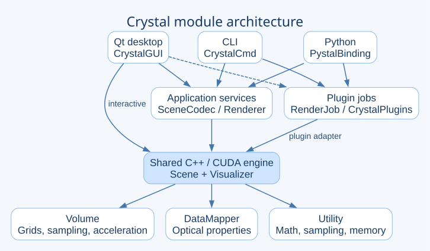
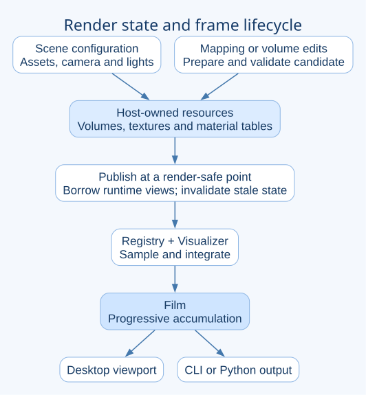
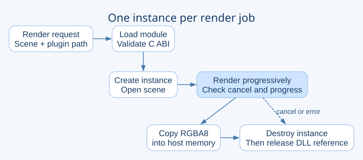
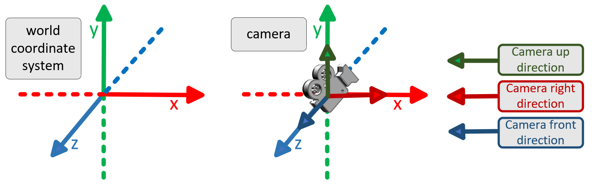
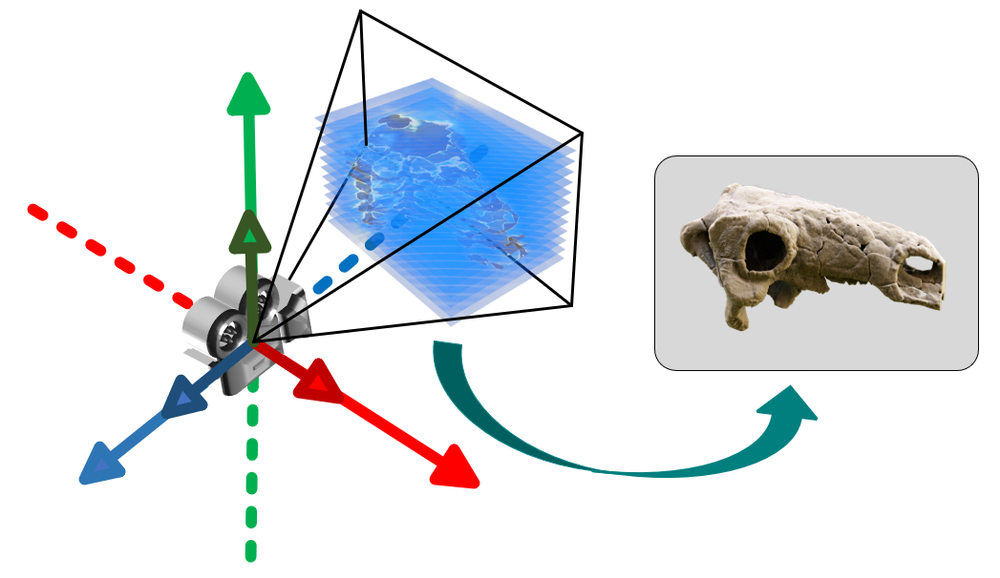
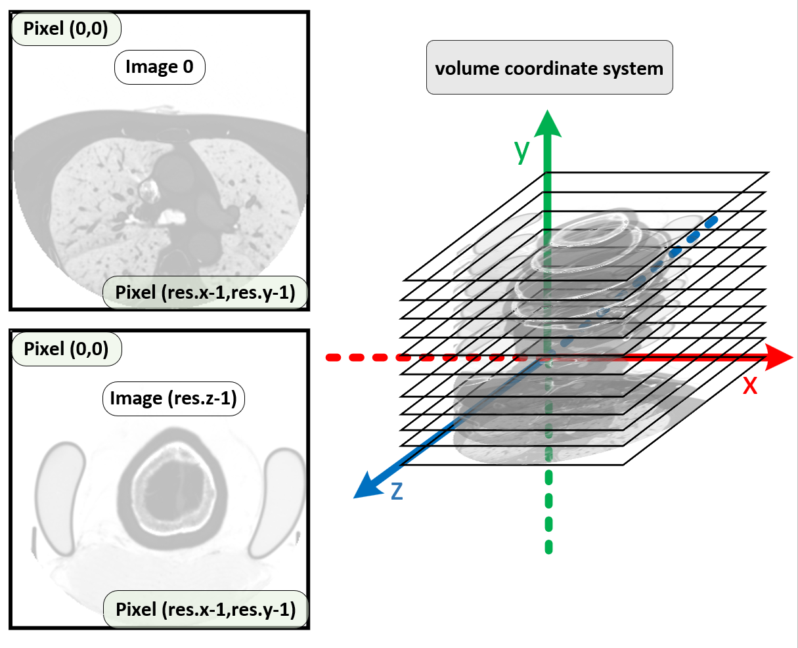
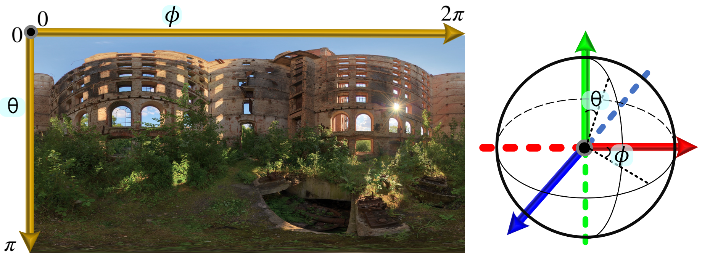
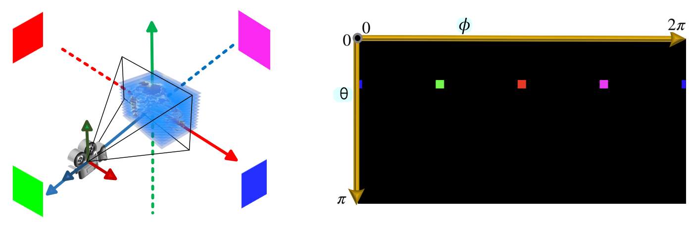
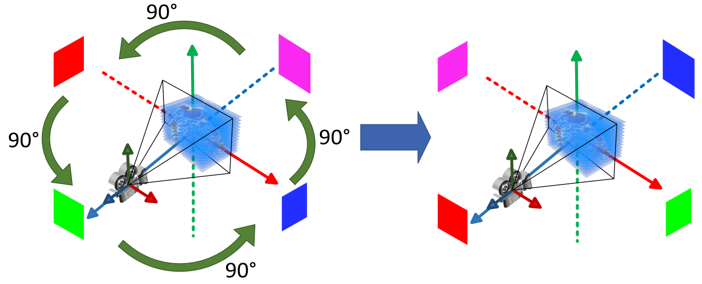

# Code Structure

[Documentation](./Documentation.md) · [Build Crystal Project](./Build_Crystal_Project.md) · [Volumes and Scenes](./Volumes_and_Scenes.md)

## Module architecture



*Figure 1. Execution routes and ownership at the module level. The graph shows the interactive viewport, public renderer and plugin job paths. The desktop architecture Help separately shows generated include dependencies.*

| Source location | Owns | Read it when… |
| --- | --- | --- |
| `src/CrystalGUI` | Home window, Qt workspaces, rendering worker and viewport, volume and mapping editors | Adding interaction, a visual control or display behavior |
| `src/CrystalCmd` and `src/PystalBinding` | CLI entry points and Python argument/array adaptation | Exposing a repeatable render workflow |
| `src/CrystalCore` | Public `Renderer`, `SceneCodec`, volume services and `RenderJob` | Loading/saving scenes, implementing a host service or dispatching a render job |
| `src/CrystalPlugins` | Versioned C ABI, plugin host and renderer adaptation | Extending a native plugin or checking compatibility |
| `src/CrystalAlgorithm/Scene`, `Camera`, `Light`, `Material`, `Shape` | Scene aggregation, camera/Film, optical inputs and geometry | Tracing camera or world coordinates, lights, shapes and materials |
| `src/CrystalAlgorithm/Visualizer` | Renderer selection and integration algorithms | Changing renderer behavior or supported combinations |
| `src/CrystalAlgorithm/Volume` and `Utility` | Typed grids, asset I/O, memory and sampling, CUDA views and acceleration | Changing layout, decoding, transforms, allocation or sampling |
| `src/CrystalAlgorithm/DataMapper` | Channel and document mapping, validation and runtime lookup data | Changing how samples become materials |
| `src/CrystalAlgorithm/Preprocess`, `Postprocess`, `DeepLearning` | Data preparation, output processing and data generation | Tracing derived data or Gaussian project export |
| `Support/PyScripts`, `Support/GS3D`, `Support/Tests` | Offline utilities, local Gaussian training and regression entry points | Reproducing a conversion, postprocessing job or test |

`scene_crystal` assembles the ordinary scene around the selected renderer. `largescale` handles the large-scale scene family. Renderer IDs and scene family names serve different purposes. Use `CrystalCmd --list-renderers` to check which renderers your build actually implements.

## Runtime lifecycle



*Figure 2. Scene assets and current settings produce a consistent render state. The renderer samples borrowed views and writes Film. Output and GUI presentation consume that result.*

1. **Decode and resolve.** `SceneCodec` reads XML/JSON where applicable. The loading plan resolves paths, checks shared source dimensions and derives the ProcessedGrid.
2. **Prepare host-owned resources.** Volume objects own buffers, arrays and texture handles. DataMapper owns compiled lookup buffers and bounds. Device structs borrow only the views they need.
3. **Publish at a frame boundary.** A complete valid candidate replaces the active state at a render-safe point. A failed preparation keeps previously committed resources. Volume, camera, lights and mapping revisions determine whether cached acceleration and Film accumulation are reusable.
4. **Render and present.** The registry and Visualizer select the algorithm. Film accumulates results. The desktop display reads the current frame and presents it in the viewport. CLI/Python return output to the caller according to their API.

For an intensity or mapping issue, trace **source sample → stored window → normalized value → compiled mapping → optical properties → renderer**. For a geometry issue, trace **SourceGrid → shared transform → ProcessedGrid → volume/world/camera transforms**. These are separate axes of diagnosis.

## Render plugin lifecycle



*Figure 3. One job owns one plugin instance. The dynamic library stays loaded until after its instances are destroyed.*

- The host validates the versioned C ABI, creates an instance, opens a scene and advances it through render steps. The job checks cancellation and can copy an RGBA8 result.
- The DLL that creates an instance destroys it. C ABI calls return a status and use a caller-owned error buffer. Borrowed image views have an explicit stride and a bounded call lifetime.
- The plugins execute in process and adapt the shared engine. The current render ABI handles scene files and frame output. Interactive camera and mask editing use the desktop scene and application interfaces.

## Keep architecture and behavior in sync

Update `Support/Docs/architecture.json` and the relevant detailed source guide when a module boundary, feature or data contract changes. The desktop Help generator embeds the reference into Crystal at build time. See [build validation](./Build_Crystal_Project.md#run-focused-regressions).

The website diagrams summarize execution and data ownership. Their editable Graphviz sources are in `documentation/diagrams/` in the website repository. The following reference retains the original coordinate, preset, volume and transfer-function material by Chunxiao Xu, PhD.

## Original technical reference

This section documents the earlier implementation. Its Volume-Loader description uses legacy classes and refers to native DICOM loading. For current volume and DICOM behavior, see [Volumes and Scenes](./Volumes_and_Scenes.md).

### Preset and Scene

The rendering system is composed of two main classes: one belonging to the Preset layer and the other to the Scene layer. A Preset class object (with the 'Preset' suffix) can be initialized from a preset file (XML or JSON). These initialized Preset objects are then used to instantiate the corresponding Scene objects.


### Coordinate System

#### Coordinate System World and Camera Coordinate System

The world coordinate system follows a **right-handed** convention.

Initially, the coordinate system followed PBRT, and then Mitsuba. For the convenience of 3D reconstruction, we change the coordinate system. Now The camera coordinate system in Crystal is the same as OpenGL.

The point cloud output will still be converted to the Colmap coordinate system.

##### Raster space and Screen space

In the camera coordinate system, the camera is oriented along the **negative z-axis**, with the up vector aligned with the **positive y-axis** and the right direction corresponding to the **positive x-axis**.



- Image Coordinate System: For an image with width w and height h  (the resolution of the film), the pixel range in the image is $[0,0]$ to $[w−1,h−1]$.
- Raster Coordinate System (for imaging film): The range of the raster coordinate system is $[0,0]$ to $[w,h]$. A pixel $[i,j]$ in the raster coordinate system corresponds to the range $[i,j]$ to $[i+1,j+1]$.
- Screen Coordinate System: The range of the screen coordinate system is $[-w/h, -1]$ to $[w/h,1]$.



In the image space, the vertical coordinate has lower values at the top and higher values at the bottom, which is the opposite of the camera's observation. Similarly, the horizontal coordinate is also reversed.
Therefore, the Screen2Raster transformation performs coordinate flipping in both the vertical and horizontal directions.

The screen in Crystal is the normal NDC space and the same as OpenGL. Namely, $x$, $y$ and $z$ are all in range $[-1,1]$. 
For Screen2Raster transformation: 
- Horizontal coordinate, Transforms the range $[w/h,−w/h]$ to $[0, w]$, where $w/h$ maps to $0$, and $-w/h$ maps to $w$.
- Vertical coordinate, Transforms the range $[-1, 1]$ to $[h,0]$, where $−1$ maps to $h$ and $1$ maps to $0$.

The near plane in NDC is $-1$, and the far plane in NDC is $+1$. The range of $z$ is also $[-1,+1]$ in Raster plane.

##### Some concept in Crystal

Now, the coordinate system of Crystal is the same as OpenGL.

In glm::perspective function, given the aspect, distance of near and far plane ($f > n > 0$), the martix is:

```text
[ 2*n/(r-l)   0          (r+l)/(r-l)      0         ]
[ 0           2*n/(t-b)  (t+b)/(t-b)      0         ]
[ 0           0          -(f+n)/(f-n)  -2*f*n/(f-n) ]
[ 0           0          -1               0         ]
```
where $l$ and $r$ represent the left and right boundaries of the near plane, respectively. $t$ and $b$ represent the up and bottom of the near plane, respectively.

When $l = -r$ and $b = -t$：
```text
[ n/r   0     0             0           ]
[ 0     n/t   0             0           ]
[ 0     0    -(f+n)/(f-n)  -2*f*n/(f-n) ]
[ 0     0    -1             0           ]
```
or using the FOV version, set $thf = \tan(0.5\cdot \text{fov}_y)$, aspect=w/h (set as ap):
```text
[ 1/(ap*thf)   0       0            0           ]
[ 0          1/thf     0            0           ]
[ 0            0     -(f+n)/(f-n)  -2*f*n/(f-n) ]
[ 0            0      -1            0           ]
```
The last line has a negative sign, which means in camera coordinate system, $[-n,-f]$ is map to $[-1, 1]$. Within the visible range (perspective projection cone), $(x,y>0)$ means they still greater than $0$ in NDC. 


#### Volume Coordinate System

The resolution of the three axes of the volumetric data is denoted as [res.x, res.y, res.z], while the voxel dimensions along these axes in world space are represented as [vs.x, vs.y, vs.z]. The resolution and voxel dimensions are multiplied element-wise to obtain the actual size of the volumetric data, denoted as [v.x, v.y, v.z]. In the local coordinate system of the volumetric space, the coordinate range of the volumetric data is from [0, 0, 0] to [v.x, v.y, v.z]. 



The origin of the visualization space is at the center of the volumetric data. The light sources are defined within the visualization space, including point lights, area lights, directional lights and panoramic HDR environment lights. All of these light sources are directed towards the origin of the visualization space and are used to illuminate the medical image volume data.

The transformation of the volume data from volume space to world space consists of the following steps: (1) translation by [-v.x/2, -v.y/2, -v.z/2]; (2) rotation (to ensure the center of rotation is at the center of the volume's bounding box); and (3) another translation.

Steps (1) and (2) are collectively referred to as the VolumeToVisSpace transformation, while the combined operations of (1), (2) and (3) are referred to as the VolumeToWorld transformation. In general, step (3) is not applied, allowing the light sources to always point towards the center of the volume data. 

#### Light Coordinate System

All fundamental light sources (point lights, area lights and directional lights) are defined using spherical coordinates (latitude and longitude), with the direction always pointing towards the origin of the visualization space, which corresponds to the center of the volume data.

The representation of HDR panoramic environment light in the [panoramic coordinate system]:



The following figure illustrates the initial state of the HDR panoramic environment light in the visualization space:



In the visualization space, the panoramic environment light is typically rotated around the y-axis. The following figure shows the result after a 90-degree rotation:



**Mitsuba .vs. Crystal**

The camera coordinate system in Mitsuba differs from that used in Crystal. Specifically, they are both the right-handed, but the orientations of the x-axis and z-axis in Mitsuba are reversed compared to Crystal.

**PBRT .vs. Crystal**

In PBRT, the camera follows left-handed coordinate system. The screen space in PBRT keeps aspect of the output image. Namely, if w > h, the width range of screen space in PBRT is $[-w/h,w/h]$, the height range remain $[-1,1]$; if h > w, the width range is $[-1,1]$, while the height range becomes $[-h/w, h/w]$.

### Volume

#### Conventional Volume Data

The rotate way of the volume is as follows: first, rotate along $x$ axis, and then rotate along $y$ axis. 


#### Volume Flip and Permute

The volumetric data may undergo flipping along the $x$, $y$, and $z$ axes, respectively. 

Additionally, it may be permuted across the $x$-$z$, $y$-$z$, or $x$-$y$ planes, which is analogous to a specific form of rotation. For example, a volume with the original resolution [A, B, C], when permuted along the $x$-$y$ plane, will have its resolution transformed to [B, A, C].


#### Volume-Loader

In Crystal, each scene preset file includes a default volume file. Users can also drag new volume files or load data from buffers. The processing logic is as follows:

- If the newly loaded volume contains only Mask1, the resolution of Mask1 must match that of the original Intensity.
- If the newly loaded volume contains both Intensity and Mask1, their resolutions must be identical.
- If the newly loaded volume contains only Intensity and its resolution differs from that of the original volume, the memory resources will be reallocated. If the resolution remains unchanged, the existing memory resources will be reused.

The default scene preset is used to initialize the [VolumeFile-Class] in the [MedicalVolumeDataPreset-Class]. And the check function [isValid-Func] in [MedicalVolumeDataPreset-Class] will initialize the [VolumeInfoPreset-Class] object using the [VolumeFile-Class] object. The volume data is initialized using [VolumeInfoPreset-Class]. 

When we load new volume file during rendering, the [.info] or [.dcm] will be used to update the [VolumeFile-Class] object. Then the [VolumeFile-Class] object is used to update the [VolumeInfoPreset-Class] object.

But the original volume may be fliped or permuted. The resolution of new volume must be compared after applying the same flip/permutation as the original volume.

In the [MedicalVolumeDataPreset-Class] (Preset), two sets of variables are maintained:
- resolution_load and voxelSpacing_load: store the original values before any permutation.
- resolution_current and voxelSpacing_current: store the permuted values after transformation.

In the [VolumeInfo-Class] (Scene), only the permuted state is retained:
- resolution: the permuted resolution.
- voxelSpacing: the permuted voxel spacing.

When a new volume is loaded, its resolution is first permuted. This permuted value is then compared directly with the resolution_current (the old permuted value) to determine subsequent processing steps.


### Transfer-Function


