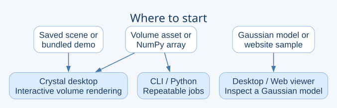

# Crystal Documentation

Use this manual to open and inspect a volume, prepare a reproducible scene, work with segmentation labels, or build and extend Crystal.

**中文速查**　第一次使用请从 [Engine-KM 示例](./Software_Operation.md#example-1-render-engine-km) 开始。导入 CT、调整强度范围和体素间距见 [体数据与场景](./Volumes_and_Scenes.md)，为分割标签着色或按框选删除体素见 [转换函数与分割](./Mapping_and_Segmentation.md)。查看和训练模型见 [3DGS 工作流](./Gaussian_Workflow.md)。

## Start with a task

| I want to… | Open this guide | What I should have at the end |
| --- | --- | --- |
| Try Crystal with the bundled data | [Software Operation](./Software_Operation.md#example-1-render-engine-km) | A visible Engine-KM render and a live sample count |
| Load my own CT and preserve spacing | [Volumes and Scenes](./Volumes_and_Scenes.md) | A saved scene and a verified, reopenable volume |
| Reveal tissue or color segmentation labels | [Transfer Functions and Segmentation](./Mapping_and_Segmentation.md) | A continuous intensity map or an exact-label mask overlay |
| Remove everything under a screen rectangle | [Rectangle volume deletion](./Mapping_and_Segmentation.md#example-3-delete-a-full-depth-region) | An inspected preview and a saved deletion sidecar |
| Inspect or refine a 3D Gaussian model | [3D Gaussian Splatting](./Gaussian_Workflow.md) | A locally viewed model or a separately saved training result |
| Configure CMake and run regressions | [Build Crystal Project](./Build_Crystal_Project.md) | A runnable Release directory and a repeatable test command |
| Find the owner of an algorithm or resource | [Code Structure](./Code_Structure.md) | A map from entry point to source directory and runtime owner |

## Choose an entry point

*Figure 1. The asset determines where to begin. A scene resumes a rendering session. An INFORAW starts with voxel data. A Gaussian model opens in a model viewer.*

- **Try it in your browser.** Open the [Crystal homepage](/) and select a published 3DGS sample.
- **Work with your own data.** Start Crystal desktop. Use a packaged demo first to establish a baseline, then open your XML/JSON or import an INFORAW volume.
- **Repeat a workflow in code.** Use the [headless CLI and Python examples](./Build_Crystal_Project.md#run-without-the-gui). Use [Datasets](./Datasets.md) to choose a volume and review its provenance.

## Read the diagrams

The [module overview](./Code_Structure.md#module-architecture) identifies source ownership. The [render lifecycle](./Code_Structure.md#runtime-lifecycle) follows a frame from scene configuration through Film and the viewport. The data guides then zoom in on [grid conversion](./Volumes_and_Scenes.md#source-grid-and-processed-grid), [material mapping](./Mapping_and_Segmentation.md#choose-a-transfer-function), and [Gaussian model production](./Gaussian_Workflow.md#model-production-and-viewing).

The desktop **Help** menu also opens the architecture reference shipped with the installed build. It includes the module index and generated include dependencies for that build.
