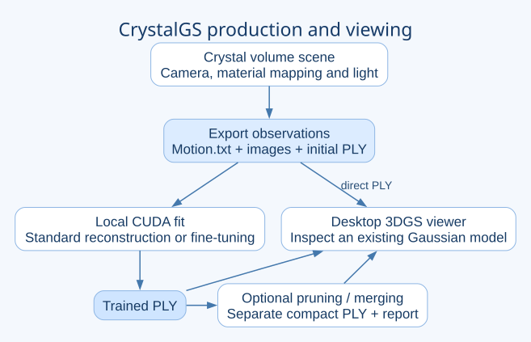

# 3D Gaussian Splatting

[Documentation](./Documentation.md) · [Crystal Web viewer](/#gaussian-viewer) · [Code Structure](./Code_Structure.md)

## Model production and viewing

*Figure 1. Use the volume renderer to produce observations, the local workbench to fit or compact a model, and a viewer to inspect the result.*

| Entry point | Use it for | Input and result |
| --- | --- | --- |
| **Crystal desktop 3DGS viewer** | Load your own model. Adjust the display box, texture, lighting, shadows or stereo. | Local Gaussian `.ply` or `.splat` → interactive view |
| **Crystal Web viewer** | Inspect the hosted samples from the homepage. | Site sample → interactive browser view |
| **Local GS3D workbench** | Train from a prepared project, evaluate held-out views, prune or merge Gaussians. | Crystal observations and an initial PLY → trained and optionally compacted PLY |

## Example 1. View a local Gaussian model

1. Drag a local 3DGS `.splat` or Gaussian `.ply` into the Crystal home window. In the resulting viewer, drag another file into the viewport to replace the model.
2. Drag with the left mouse button to orbit the model, or the right button to pan. The wheel moves the model forward or backward with the display box fixed. Double-click to reset the pose.
3. Open **View → 3DGS Controls**, or press `Ctrl+Shift+P`, to show the settings panel after closing it.
4. Adjust box depth and texture, then set the center-camera light and ambient illumination. Check shadows from several poses.
5. Choose **red–cyan** stereo for common glasses. The left view supplies red and the right view supplies green and blue. Select **red–blue** for red/blue glasses.

The PLY input must describe Gaussians, with positions, scales, rotations, opacities and spherical-harmonic coefficients. A generic point-cloud PLY can serve as an initialization for training. A `.splat` uses 32-byte records with linear scale and a WXYZ quaternion. The viewer shows a replacement after the candidate model loads successfully.

## Example 2. Generate observations and fine-tune

1. Open a volume scene and configure its camera, lighting and transfer function. In its **DeepLearning** dock, use the data generation tools to produce a project. The **3D Gaussians Ply** action controls the direct Gaussian export.
2. Confirm the project contains `Motion.txt` and `images/`. Standard reconstruction additionally uses `sparse_pc.ply`. CrystalGS fine-tuning uses `CrystalGS.ply`.
3. From your Crystal source checkout, run `Support/GS3D/Start_CrystalGS_GUI.bat`. Open `http://127.0.0.1:8765/` in your browser. The launcher serves the page and handles requests, so keep it running while using the workbench.
4. In **Python environment**, enter the absolute path to the task interpreter and click **Check & save**. Review the Python, PyTorch, gsplat and CUDA check. When an installation plan appears, review its package source and target environment before selecting **Confirm installation**. Training and view evaluation require a working CUDA environment.
5. Under **Project data**, select the project and click **Inspect**. Select **CrystalGS fine-tuning** to refine the direct model, or **Standard reconstruction** for a sparse initialization. Record your training preset, view split, seed and steps with the output.
6. Wait for the job to finish and open the resulting `Crystal_gsplat.ply` or `Volume_gsplat.ply` in the desktop viewer. Check the side and oblique views where artifacts can be more apparent than in the original preview.

## Example 3. Reduce the number of Gaussians

1. Keep the original trained PLY and record its Gaussian count.
2. In the workbench, select the existing-PLY postprocessing action or enable compaction after training. Enable **pruning** first and start with a low opacity threshold, such as `0.005`. Thin structures can be sensitive to this threshold.
3. Try **merging** in a separate output. Keep the merge radius in model/world units and review accepted pair counts before raising it. Merging also checks covariance and spherical-harmonic similarity.
4. Inspect the separate `*_compact.ply` and `*_compact.postprocess.json`. Compare the original and compact models at the same held-out viewpoints, render settings and output resolution. Record the point-count change and any visible loss, especially in thin structures and partial transparency.

Optional paired evaluation can report image metrics when a compatible manifest and CUDA are available. A smaller model can have different appearance, so use the same observations and camera poses before selecting it for a website sample.
