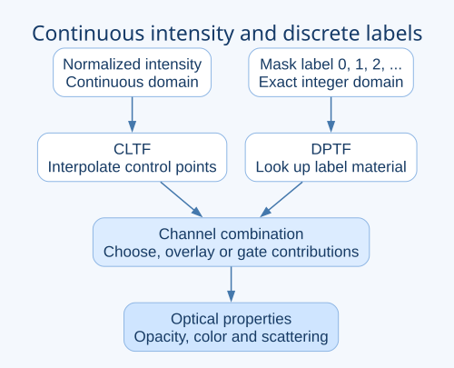

# Transfer Functions and Segmentation

[Documentation](./Documentation.md) · [Volumes and Scenes](./Volumes_and_Scenes.md) · [Code Structure](./Code_Structure.md)

In a volume scene, **Data Mapper** controls how continuous values or segmentation labels contribute optical properties. **Volume Settings** contains the tools that change label values or exclude voxels.

For step-by-step edits with before-and-after renders, open the [Transfer Function Handbook](./Transfer_Function_Handbook.md) or its [简体中文版](./Transfer_Function_Handbook_ZH.md). The exercises cover intensity curves, discrete labels, scalar–gradient mapping and optical materials for wax, jade, insect amber and a decorated Christmas tree.

## Choose a transfer function

| Mapping | Input | How it produces a material |
| --- | --- | --- |
| **CLTF**, Continuous Linear Transfer Function | Normalized continuous values such as intensity or gradient magnitude | Interpolates optical properties between adjacent control points. |
| **DPTF**, discrete value property mapping | Stable integer IDs in an eligible Mask1 or Mask2 channel | Selects the material for the exact label. An explicit entry takes priority over the default material. |

*Figure 1. In the Transfer functions tab, each enabled channel can carry its own mapping. The channel combination determines how the mapped materials contribute.*

For an editable categorical mask, use uint8 or uint16 labels, **Nearest** interpolation and the `StorageRange` value domain. Keep label reassignment disabled so an ID stays stable across reloads. An all-zero mask is valid.

Use **Advanced materials** to edit material definitions and input bindings, then validate the draft for the active renderer. The older Engine-KM screenshot shows the tab names **Legacy channels** and **Material document**. In the current GUI these are **Transfer functions** and **Advanced materials**, respectively. Use the [runtime diagram](./Code_Structure.md#runtime-lifecycle) to trace how mapping changes reach a frame.

## Example 1. Refine the intensity curve

1. Open [Engine-KM](./Software_Operation.md#example-1-render-engine-km) or work on a copy of your own scene.
2. Go to **Data Mapper → Transfer functions → Intensity**. Enable the channel and select **CLTF (linear)**.
3. Left-click a blank point on the plot to insert a node. Drag a node to adjust its position or opacity. Right-click an internal node to remove it. The endpoints remain in place.
4. Compare the render once sample accumulation settles. If the histogram is squeezed into a narrow band, inspect **Automatic intensity range** and the scene’s manual range before moving every control point.
5. Save the scene after choosing a curve that makes the expected structure visible.

The CLTF plot uses normalized intensity horizontally. Its vertical axis shows opacity. The material strips below the graph display the color and roughness associated with the curve.

## Example 2. Paint and color Mask1

1. Open **Volume Settings → Mask1 File**. Choose uint8 or uint16, click **Add Mask1**, and select a new INFORAW path beside your volume. An existing mask can be loaded as the Mask1 source if its source grid matches.
2. In **Data Mapper**, add the mapping for Mask1. New Mask1 mappings start with DPTF and the **Mask1Prior** combination. An existing scene retains its saved mapping and combination. Add label `1` with a visible material and leave label `0` transparent for this walkthrough.
3. Go to **Volume Settings → Mask1 Edit → Edit Mask1**. Set the active ID to `1` and choose **Image Brush**. Paint over a visible feature. Inspect the green preview, then click **Apply**. **Cancel Preview** clears an unapplied preview. **Undo** and **Redo** act on applied changes.
4. Use **Intensity Region** when you want a connected region around a picked voxel. Begin with a small maximum region size, choose a 6-neighbour connectivity and adjust the normalized tolerance after inspecting the preview. The current mapping must give the picked seed nonzero final opacity.
5. Click **Save Mask1** and save the scene. If Crystal asks you to write a new INFORAW for a resized mask, inspect the reopened result because resampling can change labels at boundaries.

| If you see… | Check… |
| --- | --- |
| Mask1 is loaded but its color is absent | Enable the Mask1 mapping, confirm the edited label ID, and use a combination that samples Mask1. **Intensity only** ignores it. |
| Setting Mask1 opacity to zero still shows the original volume | **Mask1Prior** falls back to intensity when the mapped mask contributes zero opacity. Choose **Mask1AsOpacity** if the mask should gate visibility. |
| No seed is selected in the brush or region tool | Start on a currently visible, undeleted voxel. Temporarily adjust the mapping if it hides the intended region. |
| Label edges blend or IDs appear changed | Check that the mask uses Nearest, StorageRange and no label reassignment. |

## Example 3. Delete a full-depth region

1. Open **Volume Settings → Rectangle volume deletion** and select **Select rectangle**.
2. Drag a rectangle in the render viewport. Verify the red preview and selected voxel count. The selection covers all voxel centers inside the perspective frustum, or the orthographic prism, within the active volume. This includes hidden voxels behind the visible surface.
3. Click **Delete selected voxels**, then inspect the result from a second angle. A changed camera or viewport invalidates the preview, so select the rectangle again after changing the view. Use the deletion panel’s own Undo or Redo if needed.
4. Click **Save deletions**. Keep the resulting `.vdel` and its XML reference together. The original intensity and mask data stay available. Reopening requires the same source and grid geometry.

Painting a mask changes labels and can change appearance through DPTF. Rectangle deletion excludes selected voxels from rendering before mapping and has its own history.
