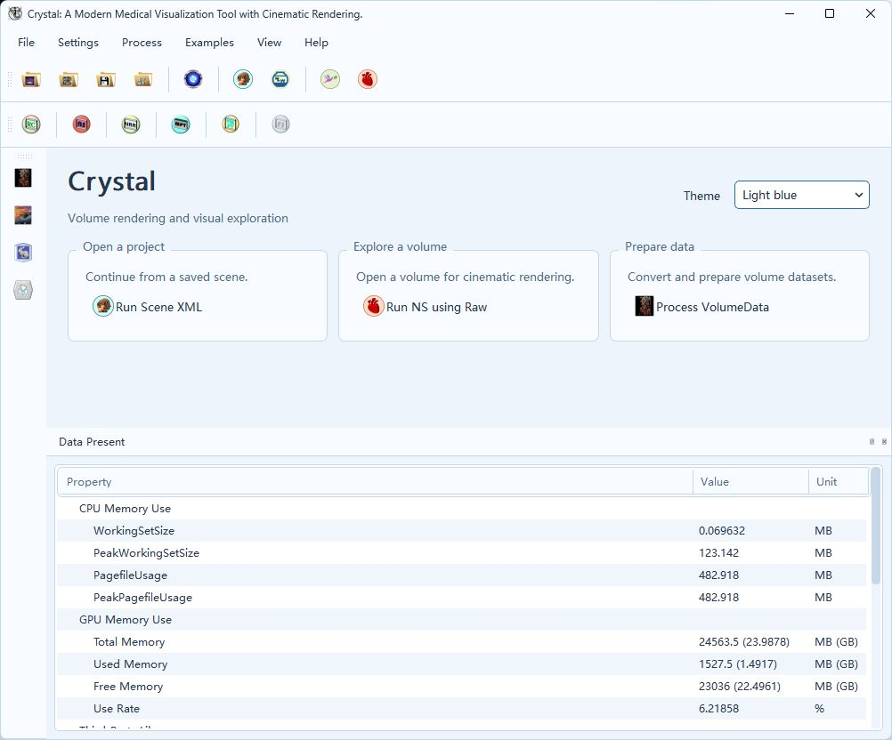
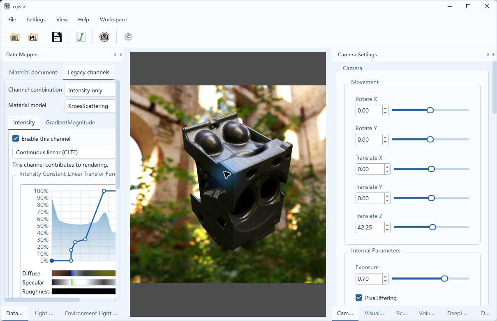
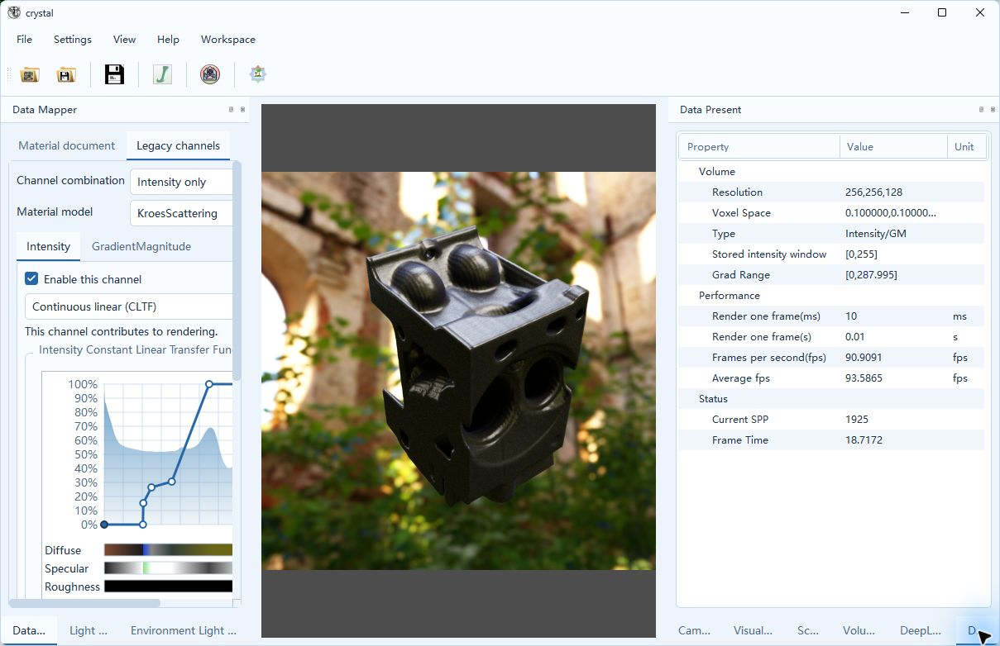
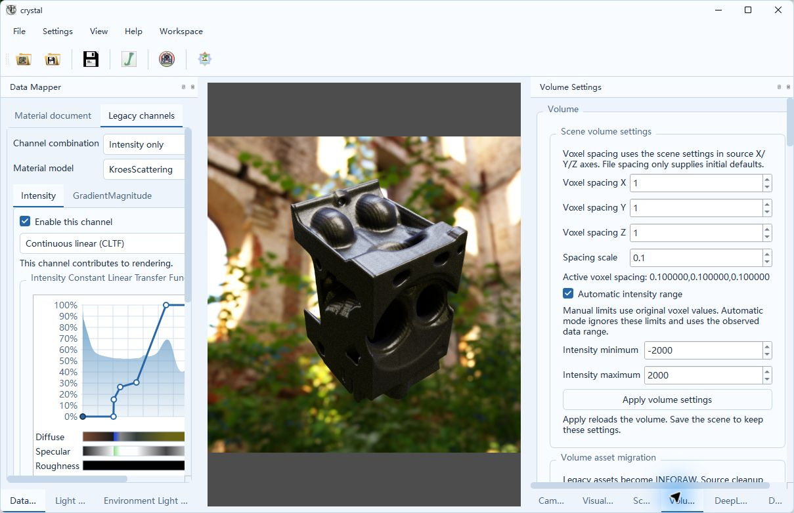
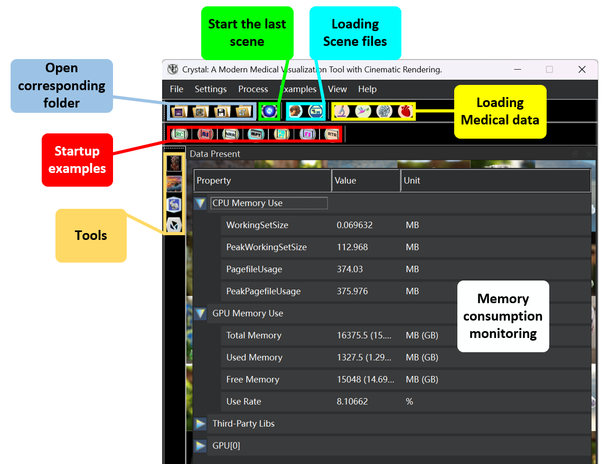

# Software Operation

[Documentation](./Documentation.md) · [Volumes and Scenes](./Volumes_and_Scenes.md) · [Transfer Functions and Segmentation](./Mapping_and_Segmentation.md)

## Start Crystal

Open `Crystal.exe` from the deployed Release directory. Keep the executable next to the deployed `Resources`, Qt runtime and renderer libraries. The **Theme** selector on the home page applies to the desktop interface. **Settings** provides the language switch.

*Figure 1. Crystal Release home window. Use the Examples menu for a known-good scene, or the central home actions to begin with your own files.*

| Starting file | Entry point | Result |
| --- | --- | --- |
| Bundled demo | **Examples** → a renderer’s examples | Loads a prepared scene and its data, mapping, lighting and camera |
| Saved XML or JSON | **Run Scene XML** or **Run Scene Json** | Opens the saved configuration and resolves its referenced assets |
| `.inforaw` or legacy `.info` | **Run NS using Raw**, or drag the volume onto the home view | Creates or opens a scene beside the volume. The directory must be writable. |
| Gaussian `.splat` or `.ply` | Drop the local model on the home window | Opens the [desktop Gaussian viewer](./Gaussian_Workflow.md#example-1-view-a-local-gaussian-model) |

## Example 1. Render Engine-KM

1. In the home window, choose **Examples → Run NS Examples**.
2. Double-click **Engine-KM** in the list. Crystal opens a separate rendering window.
3. Wait for the engine block to appear. In the default layout, **Data Mapper** is on the left, the image is in the center and view/scene controls are on the right.
4. Open the **Data Present** dock on the right. On this demo the resolution is `256 × 256 × 128`, the stored intensity window is `[0,255]` and **Current SPP** increases while the view is idle. Timing and SPP in the screenshot are observations from the test run.

*Figure 2. Engine-KM rendered in the Release desktop build. The left panel shows the saved Intensity CLTF. The right panel controls camera movement and exposure.*

*Figure 3. Data Present displays the active resolution, stored intensity window and sample accumulation.*

## Example 2. Inspect a scene before editing

1. In the Engine-KM rendering window, select **Volume Settings** on the right.
2. Compare **Voxel spacing X/Y/Z** with **Active voxel spacing**. The shipped scene shows `(1,1,1)` with a scale of `0.1`, yielding active spacing of `(0.1,0.1,0.1)`.
3. Check **Automatic intensity range**. Crystal uses the observed source range while this option is selected. Turn it off when applying a manual source-value window. Follow the [spacing and window walkthrough](./Volumes_and_Scenes.md#example-2-set-spacing-and-apply-a-manual-window) for an edited scene.
4. Use **Camera Settings** to inspect **Rotate X/Y**, **Translate X/Y/Z** or **Exposure**. After a view change, allow progressive rendering to accumulate before comparing images.

*Figure 4. Scene volume settings distinguish source-axis input fields from the effective values in the active volume.*

## Example 3. Open your own data and save a scene

1. Place a small INFORAW in a writable project directory. If you have a legacy `.info` file, keep its referenced payload beside it as specified in the descriptor.
2. Select **Run NS using Raw** and choose the volume. Crystal can create `<volume>-NS-Scene.xml` alongside it. You can also use a pre-existing XML or JSON from the corresponding home action.
3. Verify the processed resolution in **Data Present** and the active spacing in **Volume Settings**. If the background appears with no visible sample, inspect the enabled mapping channel, opacity curve and intensity window together.
4. Use **Save Scene** or **Save Scene Json**, then reopen the result from the home window. If you move the project to another folder, keep the scene and all `SceneFile` dependencies together. See [path resolution](./Volumes_and_Scenes.md#path-resolution).

## Solve common startup problems

| Symptom | Check |
| --- | --- |
| The app starts without the expected demos | Confirm `Resources/Examples-Demo` is in the deployed Release folder and use the **Examples** menu. |
| A volume was found but no scene was created | Try placing it in a directory where you can create the companion XML. Review your file type, INFORAW checksum or legacy descriptor. |
| A tab is shortened or a dock is hidden | Use the dock tabs or the **View** menu. The **Workspace** menu offers layouts for different tasks. |
| The viewport shows only the environment | Check **Data Present**, intensity window, mapping opacity, active renderer and the camera’s view of the volume. |
| The render is noisy just after a change | Pause interaction and watch **Current SPP**. Changing the camera or optical mapping can restart accumulation. |

## Earlier launcher layout

The initial guide by Chunxiao Xu, PhD illustrated the earlier launcher below. Bundled **Demo** resources lived in the software’s Resources directory, and locally managed **Example** files could be organized under `CrystalAssets`. Existing scene files can still be opened directly through the XML or JSON entry point.

