# Crystal Volume Rendering Transfer Function Handbook

<HandbookLanguage language="en" />

Learn to reveal structures in a scan, color a segmented region, and build wax, jade and insect amber from optical properties. The Christmas tree exercises show how to color ornaments that have similar CT intensities and how to check their edges at full resolution. Each comparison identifies what changed and how many samples were accumulated.

**Practice files.** Unzip into a writable folder. Follow the README to link or copy your installed volume and lighting assets. Start with a `before` scene and keep its `after` partner for comparison. The download contains ten XML files and both language guides. [Download the ten practice XML scenes and bilingual setup notes](/downloads/transfer-functions/transfer-function-exercises.zip)

[Download the complete offline handbook](/downloads/transfer-functions/crystal-tf-handbook.zip) (both languages, figures and exercises).

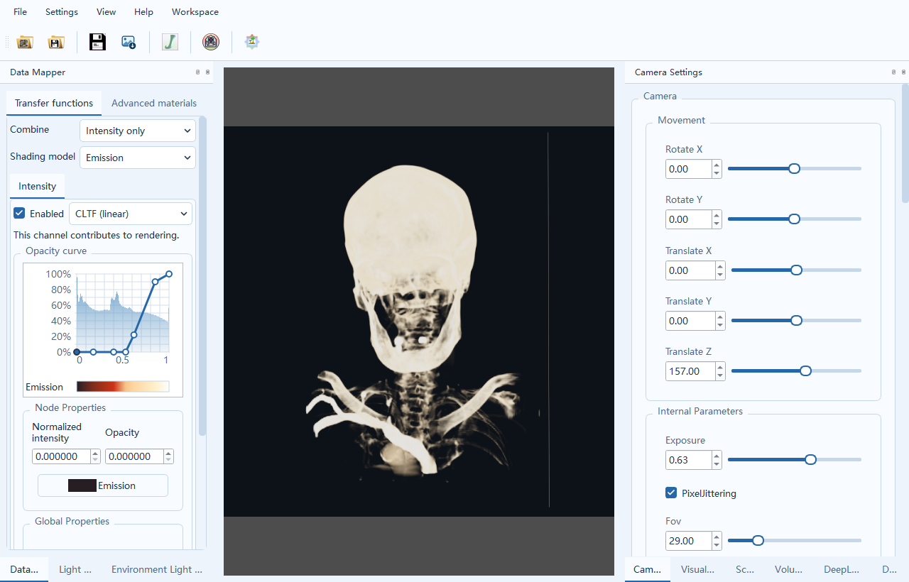

Crystal running the Manix exercise at 2048 SPP. The left dock controls the mapping and the center viewport shows the completed render.

## Set up a repeatable comparison 

1. Open a scene from **Examples**. When you import an intensity volume, start at **Data Mapper → Transfer functions → Intensity**. To keep the original settings, copy your scene XML to a new name beside the original assets and open that copy.

2. Open **Camera Settings → Film Settings → Spp Limitation**. Check **Limitation** and enter **2048**. A new scene uses this limit by default. Existing files restore their own saved settings. To change output size, enter Width and Height and press **Reset Resolution**.

3. Keep the camera, exposure and lights fixed while adjusting one property. Look for the direction of change in the interactive preview. Wait for the accumulated sample count to reach 2048 before saving a comparison.

4. Click **Quick Save PNG** before and after the edit. An ordinary scene writes a PNG beside its XML. Built-in demos write to `Save/RenderedImages` in the runtime directory. A repeated name gets `-1`, `-2` and so on. Click **Save Scene** to keep editable settings.

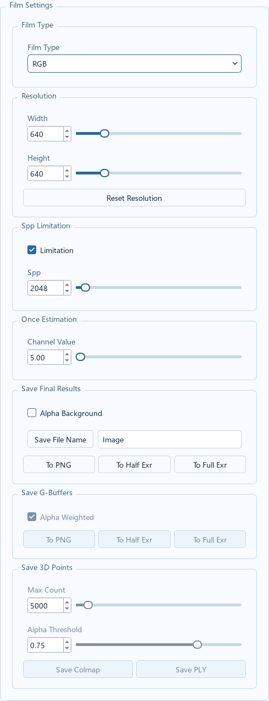

## Choose a mapping for the feature you want 

In this table, **renderer / mode** names two separate controls. [Compare the available renderer modes](#renderer-modes).

| Goal | Inputs and controls | First adjustment |
| --- | --- | --- |
| Reveal tissue in a CT | Intensity → CLTF; the exercise uses RayCasting / Normal | Set the source window, then position the rising opacity band |
| Give segmented regions independent colors | Intensity and a registered integer mask → DPTF | Select the combination, label ID, color and opacity |
| Distinguish a boundary from a uniform region of similar intensity | Advanced materials → Scalar-gradient materials | Assign appearances across intensity and gradient magnitude |
| Make wax, translucent jade or clear amber | Advanced materials → Surface/volume dielectric; SVPT / Normal | Set scattering, absorption and, for amber, the Mask1 absorption |
| Color similar-density ornaments independently | Scalar nodes and spatial rules, or a registered object mask | Isolate visible geometry first, then constrain color to the ornament |

A mask-plus-intensity mapping and a scalar–gradient grid both use two inputs. In the former, an integer can identify an object directly. In the latter, contrast and local edge strength distinguish structures. When two ornaments share both features, add position or an object label.

<ol class="handbook-flow">
<li>Intensity, gradient, label or position</li>
<li>Classify a sample</li>
<li>Look up optical properties or a material ID</li>
<li>Evaluate the renderer's optical model</li>
<li>Accumulate in the film and save</li>
</ol>

Ordinary channel edits update rendering as you work. Changes under **Advanced materials** are a draft until you select **Validate and apply**. Save the scene XML or JSON to preserve nodes, rules and material parameters.

### Renderer types and modes 

Read **RayCasting / Normal** as two menu selections. In **Visualizer Settings**, choose **RayCasting** under **Visualizer Type**, then **Normal** under **Mode Setting → Mode**. Changing the renderer changes the list of modes. The transfer function supplies properties such as color and opacity. The renderer and its mode determine how to turn those properties into an image.

**RayCasting (RC) — how the samples contribute to a pixel**

| Mode | What it does | When to choose it |
| --- | --- | --- |
| `Normal` | For an ordinary CLTF, combines samples from front to back using their mapped colors and opacity. | Start here to place the rising opacity band in a CT. Advanced local-medium and material-boundary recipes also explicitly require **RayCasting / Normal**. |
| `EmissionAbsorption` | Uses the same compositing path as Normal for ordinary transfer-function channels. | Choose it to study emission and absorption. On the same CLTF scene, switching from Normal alone should leave the appearance unchanged. |
| `SingleScattering` | On CUDA, samples one scattering event along a viewing ray. Gradient shading and volume ambient occlusion (AO) can affect that point. | Open **Manix-AO** to examine local shading and occlusion. Keep the camera, lights and transfer function fixed when comparing modes. |

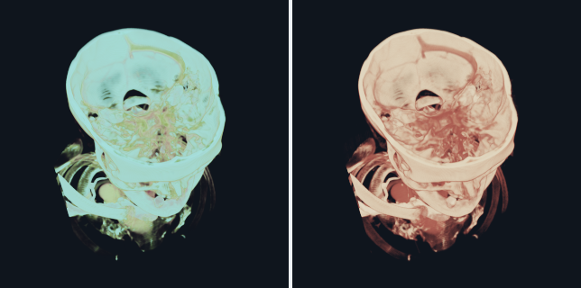

**Same scan and transfer function.** Left: RayCasting / Normal. Right: RayCasting / SingleScattering. In this Manix-AO setup, the cut surface looks pale green under compositing and warmer under single scattering, with darker recesses below the jaw. Both CUDA renders reached 2048 SPP at 320 × 320. AO and scatter-point capture were off in both. Only the mode changed. The colors come from this scene’s optical properties and lighting.

**NullScattering (NS) — how the volume path tracer finds scattering events**

| Mode | How it samples the volume |
| --- | --- |
| `Normal` | Uses the Kroes sampler for both scattering locations and visibility toward lights. |
| `RayMarching` | Tests for scattering at successive sample positions using local opacity. The sampling step influences how finely it follows the density field. |
| `KroesRayMarching` | Accumulates extinction along the ray until it reaches a randomly sampled optical depth. Select this to request the default sampler explicitly. |
| `NullScattering` | Proposes collisions using an upper bound on extinction. The local extinction determines which candidates are real interactions. This selects the null-collision sampler within the renderer of the same name. |

**Try the NS modes on one volume.** Make a copy of **Manix-KM**. With the scene closed, set `<needScatterPoints value="off"/>` under `Film` in the copied XML, then reopen it. When 3DGS scatter-point capture is on, Crystal switches to the null-collision sampler even if the saved mode says Kroes. Keep **Max Scattering**, the lighting and the transfer function fixed. First compare Normal with Kroes as a baseline, then try RayMarching or NullScattering and compare at the same accumulated SPP.

**IsoSurface — which boundary the ray hits**

| Mode | What defines the surface |
| --- | --- |
| `Normal` or `IsoValue` | Both find the first crossing from outside to an intensity **above the IsoValue threshold**. Use the source intensity scale when setting the threshold. |
| `Mask` | An available Mask1 defines the inside as **Mask1 > 0**. All positive labels form one foreground for this test. Without Mask1 the renderer falls back to the intensity threshold. |

To see the difference, use a scene with a registered Mask1, select **IsoSurface**, and move the intensity threshold in **IsoValue** mode. Switch to **Mask** and move the same threshold again. The intensity surface moves when a different level is crossed. The mask surface follows the segmented region.

**Renderers with a single mode.** **NonPhotorealisticRenderer** (NPR), **MeshPathTracing**, **VolumeMeshPathTracing** and **SurfaceVolumePathTracing** (SVPT) offer **Normal** only. For wax, jade and amber, leave SVPT on Normal and edit the optical properties under **Data Mapper → Advanced materials**. Volume photon mapping and full-scene path tracing are unavailable in this build.

For the comparisons above, use **CUDA**. The classic CPU paths for NS and IsoSurface show emission–absorption previews, and CPU RayCasting does not reproduce CUDA single scattering.

## Four principles behind the controls 

### Read the horizontal axis in source units 

A CT voxel stores a scalar. Choose a source window [L,H]. For a stored value v, the curve uses x = clamp((v−L)/(H−L), 0, 1). With the exercise window [0,2400], the node at x=0.40 targets a stored value of 960. In a window of [−1000,2000], that same node targets 200. Do this calculation before moving the curve when a familiar preset reveals the wrong structure.

The blue curve gives the **opacity you assign**. Peaks behind it show where many voxels fall. Air can produce the largest peak in a scan. To find a structure, keep the low end transparent, raise an interior point slightly, and identify what appears in the image before narrowing the interval.

### Predict what moving one node will do 

CLTF linearly interpolates between neighboring nodes. Between x₁ and x₂, t=(x−x₁)/(x₂−x₁) and p(x)=(1−t)p₁+t p₂ for an interpolated property p. With opacity nodes (0.40,0.11) and (0.53,0), the midpoint at 0.465 has opacity about 0.055. Lower the first node to zero and the entire interval clears. To keep the change local, add a control point on each side of the feature first.

Think of a ray crossing many thin layers. In front-to-back compositing, each adds “remaining transmittance × layer opacity × layer color”; the remaining transmittance is then multiplied by (1−layer opacity). Ten layers with effective opacity 0.1 obscure about 65% of the background. Here 0.1 is the effective value per layer. Converting a curve entry to a sampling-step contribution depends on the renderer, step size and density settings. Even faint tissue can obscure bone along a long path.

### Decide whether the second channel is an ID or a quantity 

A **label** identifies an object. Halfway between labels 500 and 700, linear interpolation would produce 600, which can be the ID of a third object. DPTF reads the nearest integer and looks up that entry directly. The silhouette of a coarse label volume can still show voxel steps. For a smooth, colored surface, let the continuous intensity field control visibility and use registered labels to color the intended structures. Inspect ornament rims at native image size.

A **concentration** describes how much material is present. Amber's Mask1 increases absorption inside the blow fly as the field value rises. Interpolating concentrations is physically meaningful. A **gradient magnitude** describes how quickly intensity changes in space. An intensity–gradient grid can distinguish a boundary from a uniform interior that shares its intensity. Noise also produces strong gradients, so compare the selected band with the visible anatomy.

### Read color and thickness together 

**Absorption** removes light along a path. For a homogeneous purely absorbing medium, each color channel transmits T=exp(−σₐd), where d is world-space length. Double the thickness and T becomes T². Increasing blue absorption warms transmitted light. **Scattering** changes direction, both removing light from and bringing light into the viewing ray. Nearly neutral scattering spreads light over a broader area of the wax.

The **index of refraction** controls bending and Fresnel reflection at an interface. **Roughness** changes the angular spread of reflection and transmission. Judge jade color in the thick torso and polish near a highlight. SVPT uses a base-material opacity of 1; light can still cross the surface and travel through the medium. Check voxel spacing and physical size before reusing coefficients on another object.

**SPP, output dimensions and voxel dimensions** affect different features. With independent random samples, quadrupling the sample count roughly halves the standard deviation of noise. A 1024×1024 film resolves more screen pixels. Neither change reconstructs needles lost during downsampling or repairs a color assigned to the wrong branch. To judge color leakage, fix the camera and inspect an ornament rim beside a branch at 100% pixel size.

## Read a scalar curve in the image 

Open **01-cltf-before.xml** from the exercise download. This exercise uses the Manix volume and the **RayCasting / Normal** renderer. The starting image contains a warm, partly transparent layer over the jaw, neck and shoulders. Your first edit will remove that layer and reveal the lighter structures underneath.

1. In **Film Settings → Spp Limitation**, enable the limit and enter **2048**. A change to the scene restarts accumulation. Compare images at the same accumulated sample count while keeping the camera still.

2. In **Volume Settings**, turn off **Automatic intensity range**. Set **Intensity minimum** to **0** and **Intensity maximum** to **2400**, then click **Apply volume settings**. These are values in the source volume. Inside the editor, the horizontal coordinate is the fraction of this window. A node at 0.40 represents 0 + 0.40 × 2400 = **960**. With a window of 200 to 2200, it would represent **1000**. This is why moving the window can change the image even when the curve stays in place.

3. Open **Data Mapper → Transfer functions**. Set **Combine** to **Intensity only** and **Shading model** to **Emission**. Under **Intensity**, tick **Enabled** and choose **CLTF (linear)**. The filled histogram shows where samples fall within the intensity window. The circles on the line set opacity. A tall histogram peak can stay invisible when the curve is zero across that peak.

4. Click the third circle from the left. Under **Node Properties**, check **Normalized intensity = 0.40** and **Opacity = 0.11**. Set opacity to **0** and commit the number. The ordinary channel editor updates the image directly. In the starting curve, opacity rises from zero at 0.18 to 0.11 at 0.40, then falls to zero at 0.53. Lowering the middle point makes that entire run transparent. Watch the collarbones, teeth and eye sockets become easier to separate as the warm layer recedes. Try **0.05** to keep a faint outline of the neck.

5. To build the curve yourself, click an empty position on the plot to add a point. Click a circle to select it and type its exact coordinates under **Node Properties**. Right-click an interior point to remove it. Set **Emission** with the color picker. Keep the two endpoints. Set the channel's global **Density Scale** to **1.51**. The following entries reproduce the starting curve. The color picker uses integer RGB values from 0 to 255.

| Normalized intensity | Opacity | Emission RGB |
|---|---:|---|
| 0.00 | 0 | 38, 31, 36 |
| 0.18 | 0 | 128, 46, 28 |
| 0.40 | 0.11 | 204, 51, 23 |
| 0.53 | 0 | 247, 196, 140 |
| 0.62 | 0.22 | 255, 214, 161 |
| 0.85 | 0.90 | 255, 240, 204 |
| 1.00 | 1 | 255, 255, 255 |

6. Save your scene XML and compare it with **01-cltf-after.xml**. Both reference scenes use a 29° perspective field of view, camera translation (0, 0, 157), exposure 0.63 and a constant background of (0.15, 0.21, 0.29) at scale 0.13. A PNG preserves the image. The scene XML preserves the window, curve and camera needed to repeat the edit.

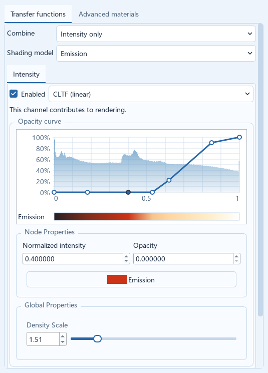

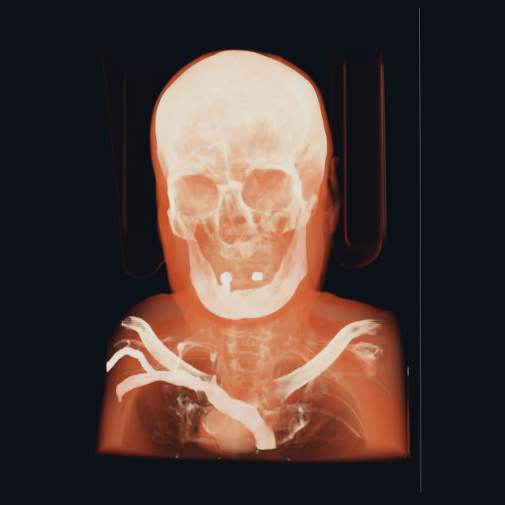

Before · Manix, 640 × 640, 2048 SPP. Warm midrange tissue overlaps the collarbones.

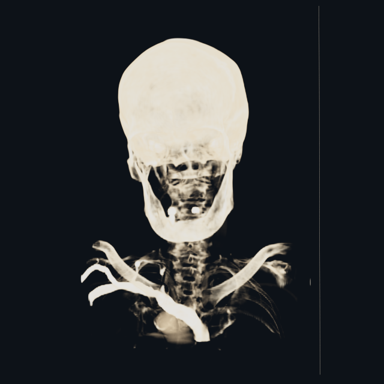

After · Same camera and 2048 SPP. Setting opacity at 0.40 to zero reveals the eye sockets, teeth and collarbones.

## Use a registered mask to reveal one label at a time 

Open **02-dptf-before.xml**. Two scalar fields now contribute to one image. The intensity volume provides variation *inside* each structure. The mask assigns one integer ID to each voxel. A continuous curve works well for the first field. A discrete table lets you change a whole labeled region with one edit. This exercise uses two one-dimensional mappings combined at render time. The advanced scalar–gradient grid has a different purpose.

1. Use the paired **BraTS-MEN** intensity and mask supplied with your installation. The source grid is 214 × 214 × 138 for both, followed by the axis permutation (0, 2, 1). Keep the intensity source as Float with trilinear interpolation and a 0–3000 source window. For the mask use UShort, **Nearest** interpolation, **StorageRange** and no label reassignment. In XML the Mask1 DataFile has `valueDomain="StorageRange"`, `reassignMaskValues="0"` and `interpolation="Nearest"`. The destination format is `DataAimFormat Mask1="UShort"`, and `ReAssignValue Mask1="0"`. These settings are already in the exercise files. The observed IDs are 0, 500, 600 and 700. An 8-bit destination cannot hold them, and interpolating between ID numbers would create meaningless intermediate labels.

2. In **Data Mapper → Transfer functions**, set **Combine → Multiply enabled channels**, and **Shading model → Emission**. Enable **Intensity** and **Mask1**. Under **Intensity**, choose **CLTF (linear)**. The normalized intensity/opacity pairs are (0, 0), (0.15, 0.04), (0.50, 0.30), (1, 0.66). Their emission RGB values are (204, 204, 204), (217, 217, 217), white and white. Set the global density scale of both channels to 1. This leaves a grayscale intensity response for the colored mask to modulate.

3. Under **Mask1**, select **DPTF (labels)**. Select **Background (label 0)** and set opacity to 0. Select **Default material (nonzero labels)** and give it opacity 0 as well. Unlisted labels will now remain transparent. To create a row, type an ID in the numeric field and click **Add label**. Use the separate drop-down list to select an existing row for editing.

4. Enter the three rows below. Change **Emission** under the selected row and set each row's density scale to 1. For a sample carrying ID 600, an opacity multiplier of zero suppresses its contribution regardless of the intensity curve. At 0.90 the intensity curve can reveal detail within the orange region.

| Mask1 ID | Emission RGB, 0–255 | Starting opacity | Finished opacity |
|---:|---|---:|---:|
| 500 | 15, 145, 207 | 1 | 1 |
| 600 | 212, 71, 10 | 0 | **0.90** |
| 700 | 194, 15, 46 | 1 | 1 |

5. With **600** selected, change only its opacity to **0.90**. Look for the orange area that appears among the existing teal and red areas. The camera translation is (2, −1, 32), field of view 29° and exposure 0.63 in both images. The exercise colors identify labels for inspection and carry no clinical interpretation.

6. If selecting 600 changes nothing, check the selected ID in the drop-down and check that **Mask1** contributes to the active combination. **Intensity only** omits this channel. If the scene disappears, check that the actual IDs have entries with visible opacity. If DPTF is unavailable, revisit the mask format, interpolation, storage range and label reassignment. Save this discrete table with the scene XML or the mapping JSON.

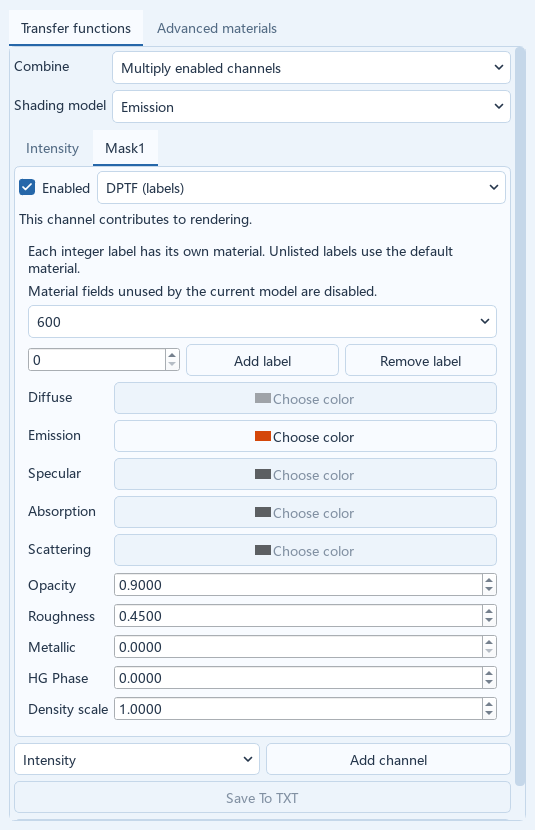

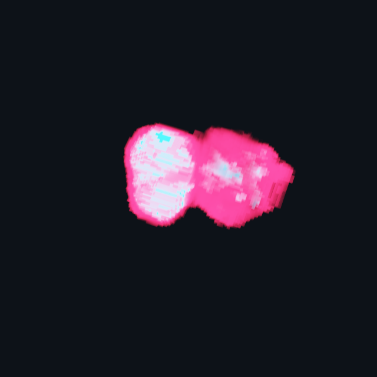

Before · Only IDs 500 and 700 contribute. 640 × 640, 2048 SPP.

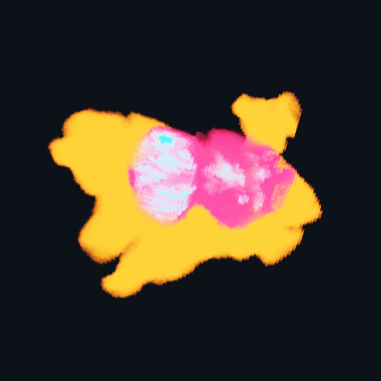

After · Raising only the opacity of ID 600 to 0.90 adds the gold region. 640 × 640, 2048 SPP.

## Use a scalar–gradient grid to separate edges 

1. Start with a copy of a volume scene with visible intensity variation. In **Advanced materials**, load **Scalar-gradient materials**, select **RayCasting / Normal** and use **Renderer attributes**. Loading a recipe replaces the current draft; save any material edits you want to keep.

2. Inspect the four bindings in the built-in 2×2 grid: lower left, lower right, upper left, upper right. They are empty, foliage, empty and gold respectively. Intensity increases horizontally. Normalized gradient magnitude divided by the gradient scale increases vertically and is limited to the grid range. Intermediate positions interpolate the neighboring appearances.

3. Set the upper-right binding to foliage and apply. Then change only that corner to gold and apply again. Inspect the interior and the boundary of the same high-intensity region. Increasing **Gradient scale** moves a given gradient toward the low-gradient row. If noise becomes colored too, start by adjusting this scale and the color contrast between rows.

4. This grid blends appearances. For a specific surface response on crossing a material boundary, select **Material interfaces** with a scalar-interval or exact-label classifier. Material interfaces use **RayCasting / Normal**, style maps use **CUDA NPR**, and the wax and jade dielectric recipes use **SVPT / Normal**. **Validate and apply** checks compatibility. Volume photon mapping currently has no implemented backend.

## Give a solid a surface and an interior 

From the launcher, choose **Examples → Run SVPT Examples** and double-click **Wax candle**, **Insect in amber** or **Jade bunny**. The exercise ZIP also contains starting and finished XML for each one. These scenes use **SurfaceVolumePathTracing / Normal**. The intensity field describes a closed shape. In **Visualizer Settings → Surface and volume**, a **Surface isovalue** of **0.5** locates its boundary. Three optical controls act at different points along a ray.

| Control | What it changes | Where to look |
|---|---|---|
| Roughness and index of refraction | Angular spread of surface reflection and transmission, bending at the boundary | Width and shape of the studio highlight |
| Absorption RGB | Light lost along the internal path, separately for red, green and blue | Color differences between thick and thin parts |
| Scattering RGB and HG phase | How often light changes direction in the interior, and its preferred scattering direction | Broad illumination, loss of a directly transmitted bright band, visibility of embedded detail |

Keep density scale at 1 and use the demo's voxel spacing for these comparisons. The solver measures travel distances in world units.

1. Open **Data Mapper → Advanced materials**. Expand **Material library → 0 → Optical parameters**. Expand an RGB property to edit the three numeric children **0**, **1** and **2** in red, green and blue order. These are linear coefficient values. A coefficient such as 2.90 is valid for absorption. Enter the numbers in **Value**, then use **Validate and apply**. For an existing demo, select **Keep current renderer and mode**.

2. To start from a clean material, first save your own copy. Select **Surface/volume dielectric** in the recipe menu and click **Load recipe**. The new draft contains one material and two scalar endpoints at 0 and 1. Both endpoints must reference the material's stable ID. The default `dielectric` ID is sufficient. Choose **Classification → Scalar materials**, **Optical contract → Surface and volume transport**, and target **SurfaceVolumePathTracing / Normal**. Use a GGX dielectric, metallic 0, emission (0, 0, 0), opacity 1, an RGB film and environment lighting. Here the renderer handles transmission through the dielectric boundary, so an opacity of 1 works for clear resin.

3. Apply the draft. Save the scene XML to keep it. Set the film limit to 2048 and compare at the same accumulated SPP. In the following pairs the camera, studio environment, exposure, ground, geometry and all other optical settings are fixed.

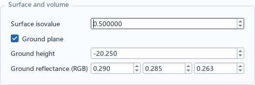

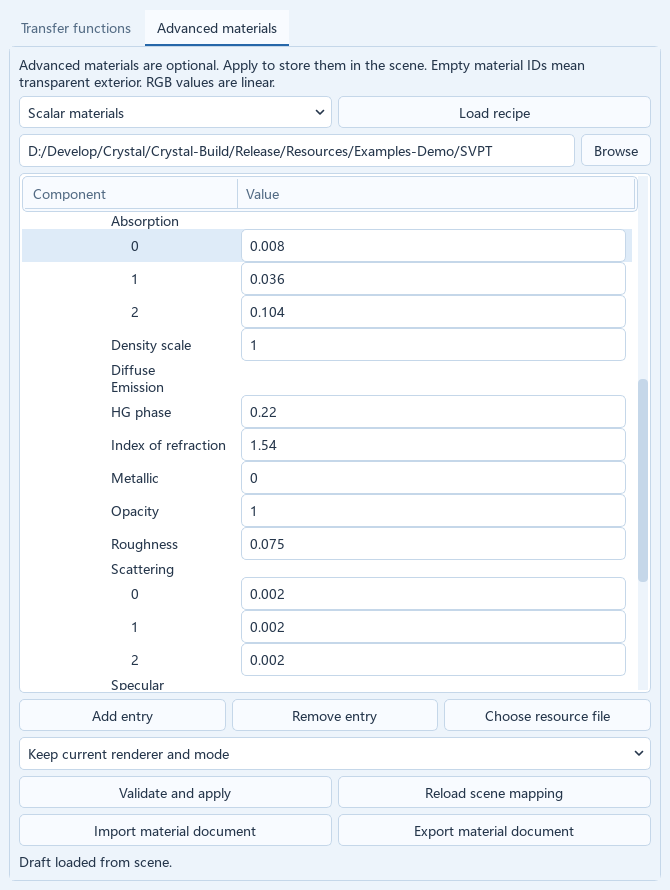

### Wax candle · spread the light through the cylinder 

1. Open **03-wax-before.xml** or **Wax candle**. The volume is a synthetic cylinder with a shallow depression at the top. In material **Ivory wax** (ID `wax`), enter absorption **(0.003, 0.011, 0.032)**, roughness **0.22**, index of refraction **1.44**, and **HG phase 0.20**. Set scattering to **(0.01, 0.01, 0.01)** and apply. Inspect the narrow, almost white transmitted band at the lower-left edge and the golden body.

2. Change only scattering to **(0.59, 0.60, 0.61)**. Apply and wait for 2048 SPP. The localized bright band weakens. Broad cream-colored illumination wraps around the upper rim and the left face, with shading still describing the cylindrical cross-section. The scattering channels are nearly equal. The larger blue absorption gives the wax its warmth.

3. To make a more translucent specimen, lower the three scattering values together. Compare the rim, body and bottom band each time. If the *hue* is too yellow once the translucency looks right, reduce blue absorption in a separate pass.

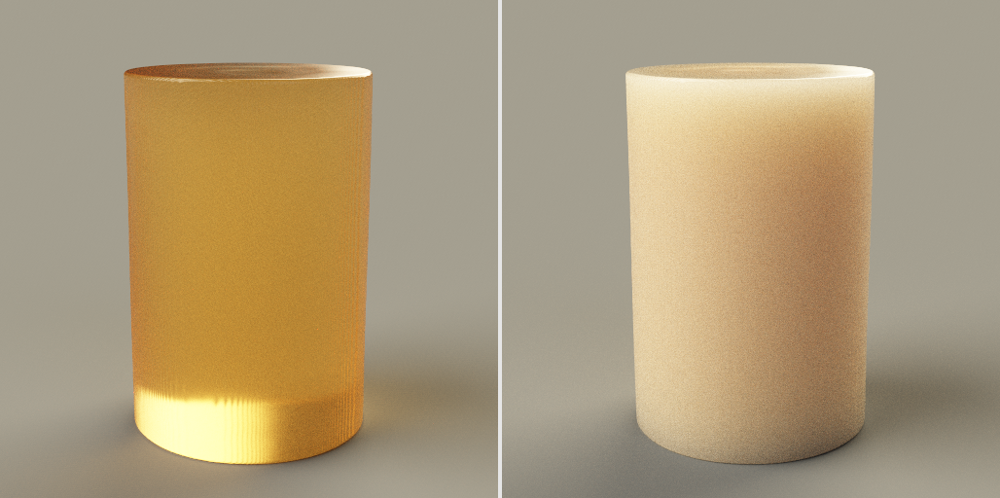

**Figure.** Wax at low scattering (left) and the ivory-wax setting (right). 512 × 512 per image, 2048 accumulated SPP.

### BugNIST blow fly in amber · tune the resin and the insect separately 

1. Open **Examples → Run SVPT Examples → Insect in amber**, or open **04-amber-before.xml** from the exercise pack. Keep the SVPT renderer in **Normal** mode with RGB film and environment lighting. The Intensity channel (`amber-nodule.inforaw`) sets the irregular resin surface at 0.5 and forms three fissures open to the exterior. Mask1 (`amber-bugnist-blowfly.inforaw`) holds the registered concentration of a real blow fly. Both use a 189 × 163 × 99 grid with 0.30 mm model spacing. The packaged XML lives under `Examples-Demo/SVPT`; both volumes live under `SceneGeometry-Demo/VolumeData/SVPT/Amber`, relative to `Resources`.

2. Open **Data Mapper → Advanced materials**. You can edit the loaded scene directly. To restore its optical recipe, select **BugNIST blow fly in amber**, then **Load recipe**. This loads a draft. The live scene changes when you choose **Validate and apply**. **Insect amber guide** opens the dedicated Help chapter. The recipe expects a registered Mask1 in the scene. Both scalar endpoints, 0 and 1, select material `amber` with opacity multiplier 1.

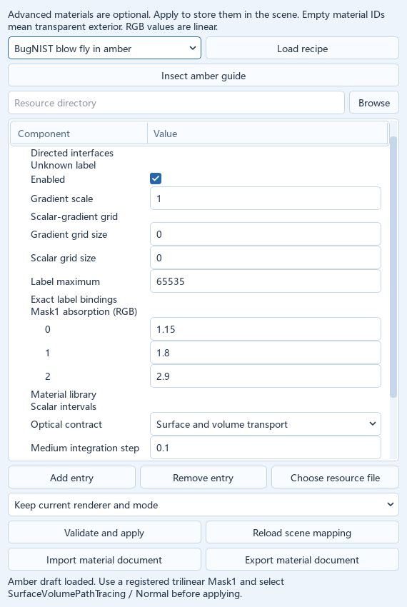

3. In material library entry 0, **Golden fossil amber**, set RGB absorption to **(0.008, 0.036, 0.104)** and RGB scattering to **(0.002, 0.002, 0.002)**. Use density scale **1**, roughness **0.075**, refractive index **1.54**, HG phase **0.22**, metallic **0** and opacity **1**. Blue light is absorbed fastest, so thicker resin looks more golden. Roughness spreads the highlight. Raising scattering can veil the insect even when its own absorption is unchanged.

4. Return to the root of the tree and expand **Mask1 absorption (RGB)**. Enter **(0, 0, 0)**, choose **Validate and apply** and wait for 2048 SPP. Keep the camera still. Compare this clear resin with **(0.575, 0.90, 1.45)** and then **(1.15, 1.80, 2.90)**, applying each time. Look first at the thorax, then at the faint edge of a wing. Use a fissure as a landmark to check that only the inclusion changes.

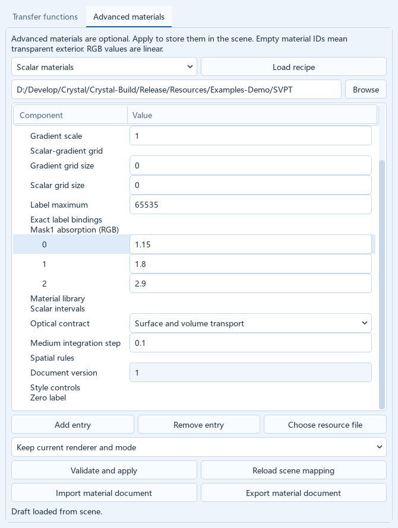

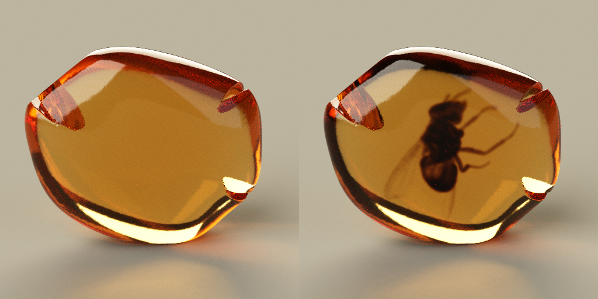

**Zero and full strength.** Each side is a 512 × 512 SVPT render at 2048 accumulated SPP with identical lighting and camera. Follow the chest, legs and wings. The cracks are visible in both views because they belong to the resin surface.

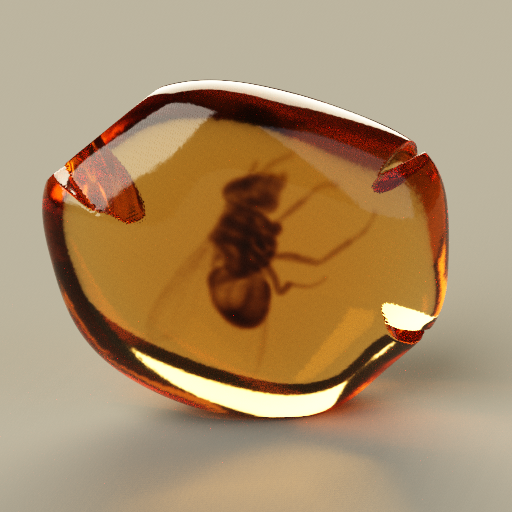

**Half strength.** Compare the light transmitted through the abdomen with the full-strength render. The finer wing still transmits more light than the thick body.

5. **Why the two controls work.** At a point inside the resin, the fly adds absorption in proportion to the sampled Mask1 concentration. Over a ray segment, the extra transmission in color channel c is `exp(−k_c × ∫ m(s) ds)`. Here `m` is the trilinearly sampled concentration, `s` is distance in the scene, and `k_c` is one of the three root coefficients. For one unit of integrated concentration, green light retains about 41% at half strength and 17% at full strength, before accounting for the resin and other light transport. Long paths through the body accumulate more absorption. Thin wings remain translucent.

6. **Check your edit and save.** If the entire nodule darkens, check the base-material absorption. If the fly is missing or displaced, check Mask1 registration, trilinear interpolation, original UChar concentration values and the three root coefficients. This example scales the insect for the composition. When changing model scale, compare at a fixed view and retune absorption to the new path lengths. Save the applied draft to a scene XML. The demo uses specimen `spy_1_040`. [BugNIST dataset](https://abdahl.github.io/bugnist/) · [Research paper](https://doi.org/10.1007/978-3-031-73411-3_2)

### Jade bunny · choose a color by what the stone absorbs 

1. Open **05-jade-before.xml** or **Jade bunny**. The watertight bunny mesh has already been voxelized as `jade-bunny.inforaw`. In **Celadon jade** (ID `jade`), enter scattering **(0.22, 0.25, 0.225)**, roughness **0.37**, index of refraction **1.61**, and HG phase **0.32**. Begin with neutral absorption **(0.044, 0.044, 0.044)**. Apply. The grayish torso and the pale ear highlights give two useful reference areas.

2. Hold blue at **0.044**, increase red absorption to **0.070** and decrease green absorption to **0.027**. Apply. More green light survives paths through the body. Compare the torso midtones and both ear rims. The torso develops a celadon green while the ears retain their pale highlights.

3. For a less saturated stone, bring red and green absorption back toward 0.044. To change its apparent polish, make a second comparison with a different roughness. Keeping the two experiments separate makes it possible to see which edit changed the body color and which changed the highlights.

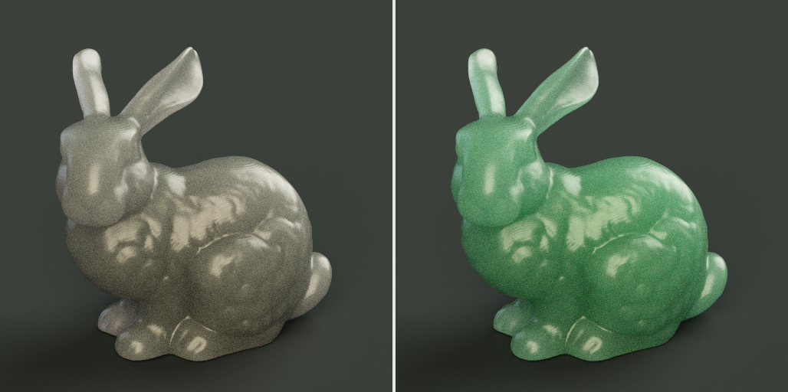

**Figure.** Equal-channel absorption (left) and selective absorption for celadon jade (right). 512 × 512 per image, 2048 accumulated SPP.

If an edit appears to do nothing, inspect the status under **Validate and apply**. **Reload scene mapping** restores the last applied version of the draft. An unexpectedly dark result on a larger model can reflect longer world-space paths. Check the physical spacing and thickness before reducing the coefficients.

## Christmas tree CT — assign different appearances to similar densities 

A CT scanner measures attenuation. Two decorations can therefore have similar scalar values even if you would like one to be blue and the other red. First classify the scalar into air, foliage and dense decorations. Then use a second signal to choose the appearance of particular decorations. Crystal can use position for a rough selection or a registered label for an individual object. In the published Christmas tree example, Igouchkine, Zhang and Ma use auxiliary fields that vary along the spatial axes to assign appearance by location. This gives the reasons for both the colored ornaments and occasional color spill onto other structures in the same region. [Original paper](https://doi.org/10.1109/TVCG.2017.2784830) · [TU Wien scan acquisition](https://www.cg.tuwien.ac.at/page/xmas/)

### Build the intensity-only baseline 

These controls describe the **original Christmas tree CT**, which uses a single intensity volume. Use this exercise if you have `Christmas_tree-02.xml` and its `christmas_tree_512x499x512_uint16.inforaw`. Save a private copy. The separately bundled **Decorated Christmas tree** demo supplies its own registered object labels. The boxes below are aligned to the original CT.

1. Set **Film Settings → Spp Limitation** to **2048** and enable the limit. The original CT scene specifies 1. Keep the original camera and three directional lights, perspective FOV **29°**, exposure **0.9** and the volume window **0–4095**. The original samples use a 12-bit value range stored in UShort. Keep the full volume bounds, permutation **(0, 2, 1)** and flip **(0, 0, 0)**.

2. Open **Data Mapper → Advanced materials**. Enable the document and set **Classification → Scalar materials**. In **Material library**, use the entries below. If rebuilding the document, select the library and click **Add entry**. Give each entry its **Stable material ID**. The display name can be descriptive; enter the exact ID when a node or rule asks for **Material ID**. Use linear RGB for the numeric components, set specular to (0.04, 0.04, 0.04) throughout and leave absorption, scattering and emission at zero.

| Stable ID | Surface reflection | Diffuse RGB | Roughness | Metallic |
|---|---|---|---:|---:|
| foliage | Lambert | 0.060, 0.180, 0.018 | 0.80 | 0 |
| metal | GGX | 0.950, 0.650, 0.230 | 0.25 | 0.85 |
| red | GGX | 0.550, 0.008, 0.018 | 0.22 | 0.60 |
| blue | GGX | 0.008, 0.035, 0.500 | 0.22 | 0.60 |
| purple | GGX | 0.240, 0.006, 0.150 | 0.22 | 0.60 |

3. For this three-image comparison, choose **Optical contract → Renderer attributes**, target **RayCasting / Normal** and turn on gradient shading. Remove existing entries from **Directed interfaces** and **Spatial rules** in your working copy. Set the material opacity of `foliage` to **0.28** and the remaining four to **1**.

4. Under **Scalar intervals**, add the six positions below. Use an opacity multiplier of **1** for every row. Leave the Material ID field empty at the first two positions. Click **Validate and apply**. In image A the needles appear green and the dense ornaments and topper share the gold appearance. Two consecutive transparent nodes keep air transparent up to 0.0193. A single transparent endpoint followed by a visible node creates an opacity ramp across that gap and can hide the tree behind faint material.

| Scalar position | Material ID |
|---:|---|
| 0 | empty |
| 0.0193 | empty |
| 0.0200 | foliage |
| 0.100 | foliage |
| 0.159 | metal |
| 1 | metal |

### Add and test one spatial rule at a time 

1. In **Spatial rules**, select the collection and click **Add entry**. Expand the new row. Choose **Composition → Replace appearance**. For the first rule use minimum position **(0.15, 0.12, 0.12)**, maximum position **(0.43, 0.44, 0.85)**, minimum scalar **0.053724** (220/4095), maximum scalar **1**, material **red** and opacity multiplier **1**. Each position has children 0, 1, 2 in X, Y, Z order.

2. Click **Validate and apply**. Rotate the tree, then restore the comparison view. The box moves with the volume because its coordinates are normalized across the full grid *after* the axis transform. All samples satisfying both the box and scalar range qualify. A region of empty air remains empty when you replace only appearance.

3. Complete the five rules in the following order, reusing the scalar limits above. Where multiple rules match, the later appearance assignment wins. Image B shows several differently colored ornaments. Inspect the neighboring twigs as well as the ornaments.

| Order | Minimum XYZ | Maximum XYZ | Appearance material |
|---:|---|---|---|
| 0 | 0.15, 0.12, 0.12 | 0.43, 0.44, 0.85 | red |
| 1 | 0.52, 0.15, 0.12 | 0.84, 0.48, 0.85 | blue |
| 2 | 0.32, 0.35, 0.12 | 0.64, 0.62, 0.85 | purple |
| 3 | 0.55, 0.50, 0.12 | 0.85, 0.78, 0.85 | red |
| 4 | 0.16, 0.53, 0.12 | 0.44, 0.78, 0.85 | blue |

4. Change the minimum scalar in all five rules from **0.053724** to **0.158730** (650/4095) and apply. In image C, compare the same clusters of needles and the same thin ornament shells. A higher threshold returns some twigs to green. A shell that crosses the density cutoff or box edge can acquire two colors. Narrow the box for a small correction, or use a registered object label to select an entire decoration. A longer render can reduce sampling noise; object boundaries follow the classifier.

5. Save the XML after applying your changes. **Export material document** can also preserve the mapping for reuse. **Import material document** loads a draft, which you can check and apply for the new scene.

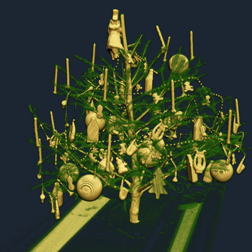

A · Intensity alone.

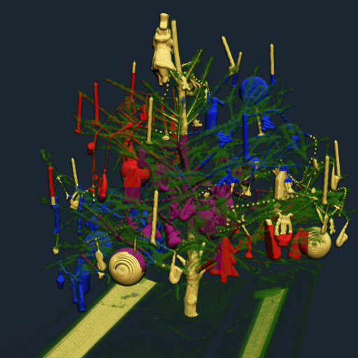

B · Five spatial rules start at 220/4095.

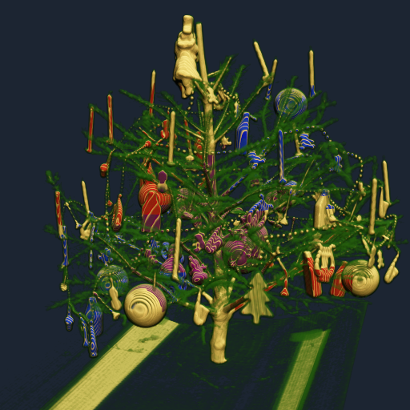

C · The same rules start at 650/4095. Compare the branches and the concentric colors on the thinner shells. All three are 512 × 512 at 2048 SPP, with the same camera.

### Advanced exercise · shade a crossing between two materials 

The original CT scene also demonstrates **Material interfaces**. Here a boundary crossing selects the surface material and a coverage per crossing. A ray entering foliage from empty space and a ray leaving foliage encounter different *ordered* pairs. An exhaustive set of the relevant directions lets both the front and back of a structure contribute.

1. Work in a new copy. Keep **RayCasting / Normal**, switch **Optical contract** to **Material interfaces**, restore foliage material opacity to **1**, and turn off the ordinary gradient shading used for images A–C. For this classifier restore four scalar positions and IDs: 0 → empty, **80/4095 ≈ 0.019536** → foliage, **650/4095 ≈ 0.158730** → metal, 1 → metal. Restore the five appearance boxes with a minimum scalar of 220/4095.

2. Under **Directed interfaces**, create both directions for each pair below (six rows total). Leave the exterior ID field empty. Set **Medium integration step = 0.20**. The original scene has no optical absorption or scattering in its component interiors.

| Crossing, entered in both directions | Surface material ID | Coverage per crossing |
|---|---|---:|
| empty ↔ foliage | foliage | 0.40 |
| empty ↔ metal | metal | 1.00 |
| foliage ↔ metal | metal | 1.00 |

3. Apply and examine the overlapping foliage and the specular response of the topper. If the first image stays dark, check that a frame has actually completed. Then inspect both directions of the exterior crossings, the IDs, the lighting and the 0–4095 window. The original volume resampling scale of 0.75 also limits the detail in fine needles. Images A–C in the preceding exercise used the renderer-attributes contract.

Igouchkine, Zhang and Ma used position-dependent auxiliary volumes to assign different surface appearances to similar densities. In Crystal, a box plus a scalar gate is a practical way to test that idea; a registered mask can identify an individual ornament more precisely. [Original paper, section 5.4 and figure 14](https://doi.org/10.1109/TVCG.2017.2784830) · [Original Christmas tree CT](https://www.cg.tuwien.ac.at/page/xmas/)

## Recolor an ornament in the bundled Christmas tree demo 

Choose **Examples → Run RC Examples → Decorated Christmas tree**. The demo ships with two registered 320×312×320 volumes totaling about 16.2 MiB. It uses gradient shading in RayCasting / Normal, a 1024×1024 film and a 2048 SPP limit.

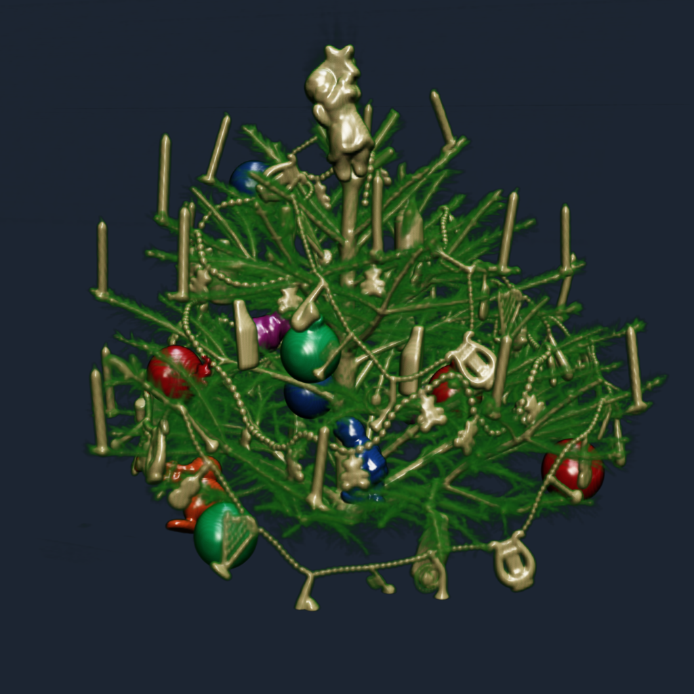

1. In **Data Mapper → Transfer functions**, switch **Combine** to **Intensity only**, then back to **Multiply enabled channels**. Intensity determines how the foliage, topper and bead chain become visible. Restoring the mask gives similarly dense ornaments their own colors.

2. Select **Mask1 → DPTF (labels)** and choose existing label **1** in the entry list. Change its **Diffuse** from garnet to pale blue. Watch only the ornaments carrying that ID change. Leave opacity at 1 and specular white. Check the gold chain and green branch in front of the ball. The palette below uses linear RGB; for an 8-bit picker multiply each component by 255 and round.

3. Switch to **Intensity**. The window is 0–4095. Stored value 73 corresponds to x≈0.01783 with opacity 0.243. Try lowering that node to 0.135 and inspect the branch in front of the central green ball. Restore the setting. To reveal the bottom band containing the scan support, set label 6 opacity from 0 to 1.

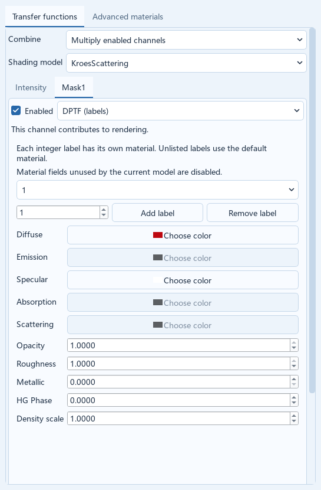

| ID | Starting diffuse RGB | Purpose |
| --- | --- | --- |
| 0 | 1, 1, 1 | Pass through the branch and chain colors from intensity |
| 1 | 0.74, 0.032, 0.061 | Garnet |
| 2 | 0.045, 0.19, 0.92 | Cobalt |
| 3 | 0.029, 0.73, 0.54 | Turquoise |
| 4 | 0.49, 0.070, 0.73 | Amethyst |
| 5 | 0.99, 0.23, 0.105 | Coral |
| 6 | 1, 1, 1 | Bottom support band; default opacity 0 |

### Inspect color leakage at full image resolution 

These matched renders change only the coloring mask. Both use the same compact CT, lighting, camera and 2048 SPP. Left uses five intensity-gated spatial boxes. Right uses registered object labels. Each patch contains 264×194 original pixels.

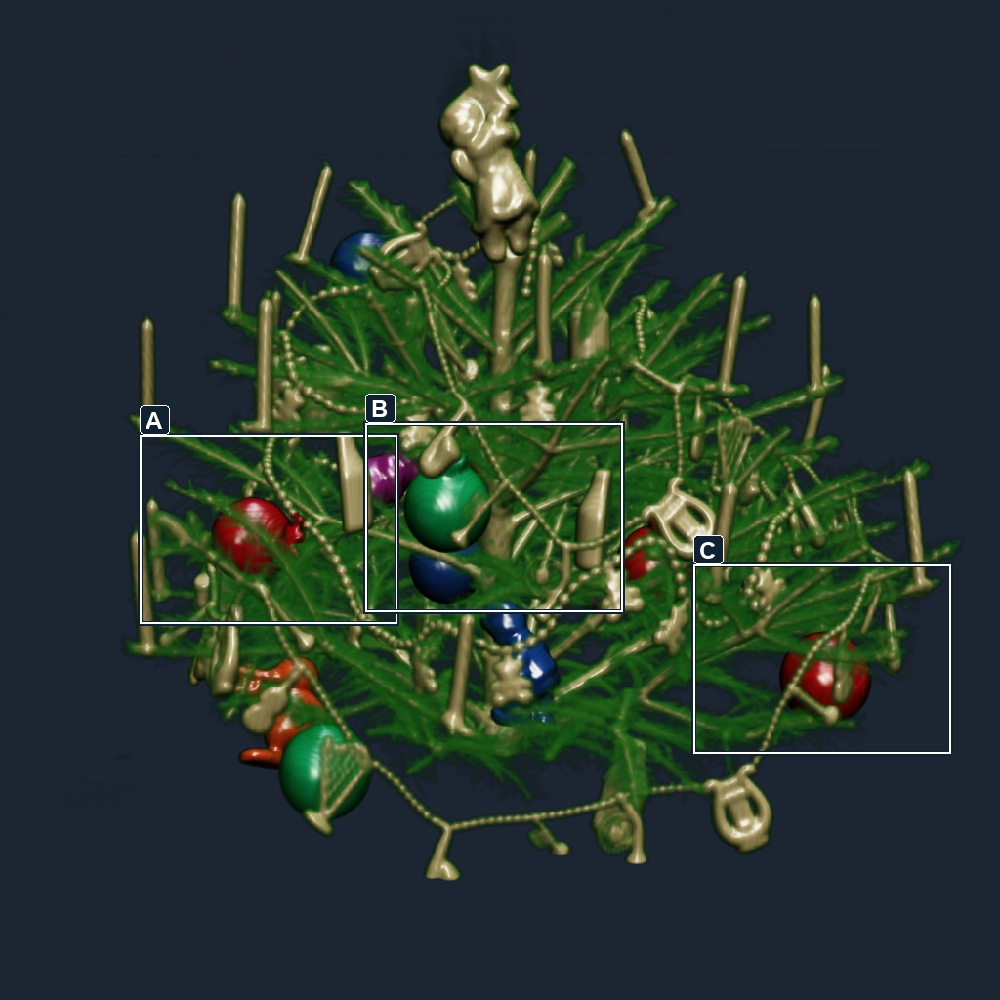

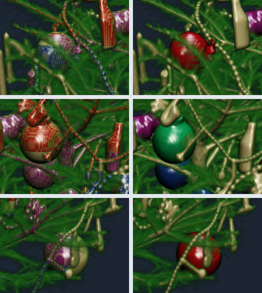

**A, left red ornament.** Follow the green branch in front of the shell. The object mask keeps the shell red and the neighboring bead chain gold. **B, central green ornament.** The stepped red patches give way to one green shell with a localized highlight. The blue ornament behind it remains distinct. **C, lower-right red ornament.** The foreground sprig and gold strand retain their colors across the shell. Some highlights retain fine scan texture, and the thinnest downsampled needles remain soft.

To adapt the approach, prefilter the continuous scan before downsampling and use the same grid and axis transform for the label field. For this CT, six-connected components at stored intensity ≥320 were retained on a filtered copy if they contained at least 2,500 voxels and spanned 18–55 cells along every axis. Eleven ornaments passed. Their color regions extend up to three cells beyond their supports so the palette boundary can fall in low-opacity material. Trilinear intensity determines the visible outline; nearest-neighbor sampling preserves each integer palette ID. Refit the thresholds for a different scan. The palette is an artistic choice. Original scan by Armin Kanitsar, 2002. [Original acquisition](https://www.cg.tuwien.ac.at/page/xmas/) · [Open data source](https://github.com/InsightSoftwareConsortium/OMEZarrOpenSciVisDatasets#christmas_tree) · [CC BY 4.0](https://creativecommons.org/licenses/by/4.0/)

[简体中文](./Transfer_Function_Handbook_ZH.md)
