# Crystal 体渲染转换函数操作手册

<HandbookLanguage language="zh" />

先用一条不透明度曲线把感兴趣的组织显出来，再用颜色、散射和表面反射做出材质。练习从 CLTF 与 DPTF 开始，随后分别制作蜡烛、琥珀、玉兔和多材质圣诞树。对照图固定相机和光照，便于把外观变化对应到具体操作。

**练习文件。** 解压到可写目录，按包内说明准备本机已有的体数据和环境贴图。先打开带 `before` 的练习，保留 `after` 用于核对。包含十个 XML 及中英文说明。 [下载十个练习场景和双语配置说明](/downloads/transfer-functions/transfer-function-exercises.zip)

[下载完整离线手册](/downloads/transfer-functions/crystal-tf-handbook.zip)，内含中英双语正文、全部插图和练习文件。

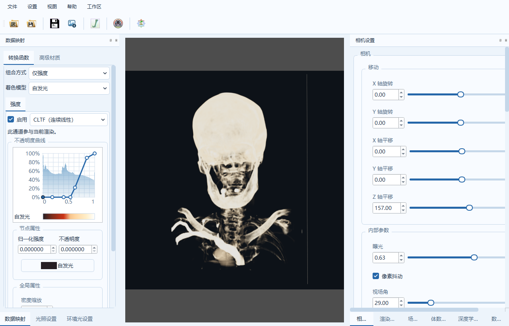

Manix 练习在 Crystal 主窗口实际达到 2048 SPP。左侧是数据映射，中央是对应的骨结构。

## 开始前先固定比较条件 

1. 在启动器的「示例」打开要练习的场景。新拖入一个强度体时，先打开左侧「数据映射 → 转换函数 → 强度」。已经带有高级材质的场景会有自己的配方。想保留原作时，可在原目录复制一份场景 XML，给副本加上练习编号，再打开副本。相对路径仍能找到体数据。

2. 展开「相机设置 → 成像设置 → 采样数限制」，勾选「限制」，把「每像素采样数」设成 **2048**。新场景默认就是这个值；打开旧场景时先看它保存了什么。需要改变输出尺寸时，填写宽和高，点「重置分辨率」。像素数决定能看到多细的形状，SPP 决定每个像素平均取多少次样本。

3. 每次练习固定视角、光源和曝光。先改一个参数，看它影响的是轮廓、厚处的透光颜色，还是亮部的宽窄。交互时可以先看变化方向，保存对照图要等实际累计达到 2048。改变材质、相机或灯光后要重新累计。

4. 用工具栏「快速保存 PNG」存下调整前的图，再改参数、重新累计、保存调整后的图。普通场景的 PNG 在 XML 所在目录，以场景名命名；同名依次加 `-1`、`-2`。启动器的内置 Demo 写到运行目录的 `Save/RenderedImages`。要让下次打开也能继续编辑，请另点「保存场景」。

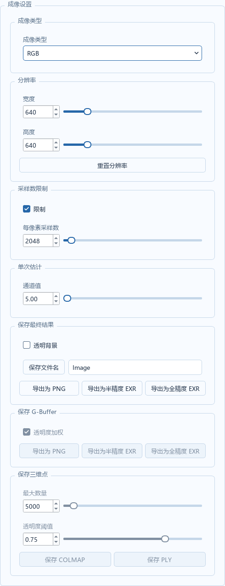

## 根据手头的数据选择工具 

表中的 **渲染器 / 模式** 对应两个独立选项。[查看各渲染器的模式对照](#renderer-modes)。

| 想做什么 | 数据与入口 | 首先调整什么 |
| --- | --- | --- |
| 在 CT 内显出一层组织 | 强度 → CLTF；本练习用光线投射 / 标准 | 原始强度窗口、不透明度起升的位置 |
| 给已分割的区域逐类着色 | 强度 + 配准的整数 Mask → DPTF | 组合方式、标签 ID、标签颜色和不透明度 |
| 区分强度相似但边缘强弱不同的组织 | 高级材质 → 标量—梯度二维材质 | 在强度与梯度两维分配材质 |
| 做蜡、半透玉石、透明虫珀 | 高级材质 → 表面与体介电材质；SVPT / 标准 | 散射、分通道吸收，以及虫珀的额外 Mask1 吸收 |
| 给原始无标签的圣诞树挂饰分色 | 高级材质 → 标量节点和局部空间规则；光线投射 | 先筛出高密度装饰，再区分其空间位置 |

把一份配准的 Mask 与强度组合、用强度和梯度定义二维材质表，是两种不同操作。前者能直接指定“这一类体素是哪一件物体”；后者利用局部信号的差异。如果两个挂饰的强度和梯度都相近，给它们不同颜色还需要空间位置或标签。

<ol class="handbook-flow">
<li>体数据中的强度、梯度、标签或位置</li>
<li>把样本归入可见结构</li>
<li>转换函数给出颜色、不透明度或材质 ID</li>
<li>渲染器按支持的模型计算光照</li>
<li>Film 累计，保存图像和场景</li>
</ol>

在「转换函数」里改连续节点或标签会触发渲染更新。「高级材质」有自己的草稿，改完一组参数要点「验证并应用」。材质库、规则与节点都随场景 XML/JSON 保存；普通 CLTF 练习只需场景和体数据。

### 渲染器类型和运行模式 

表中的 **RayCasting / Normal** 是两个下拉框的取值。在「渲染器设置」中，先将「渲染器类型」选为「光线投射」，再到「模式设置 → 模式」选「标准」。换一种渲染器，可选模式也会改变。转换函数把体数据映射为颜色、不透明度等属性；渲染器和运行模式决定这些属性怎样形成图像。

**光线投射（RayCasting，RC）：采样点怎样贡献到一个像素**

| 模式 | 实际作用 | 什么时候选 |
| --- | --- | --- |
| 标准 `Normal` | 对普通 CLTF，沿视线从前向后，按映射出的颜色和不透明度合成。 | 调 CT 的不透明度曲线时从这里开始。高级材质中的局部介质、材质界面配方也明确要求选择「光线投射 / 标准」。 |
| 自发光与吸收 `EmissionAbsorption` | 对普通转换函数通道，与「标准」使用同一条合成路径。 | 适合研究自发光和吸收。同一 CLTF 场景中，只把「标准」切换成这一项，外观应当一致。 |
| 单次散射 `SingleScattering` | CUDA 沿观察射线采样一次散射事件，可在该点计算梯度光照和体环境光遮蔽（AO）。 | 打开 **Manix-AO** 观察局部光照与遮蔽。比较模式时保持相机、灯光和转换函数不变。 |

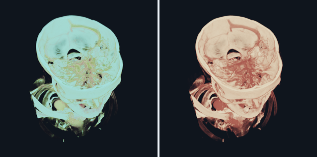

**同一体数据、同一转换函数。** 左图为「光线投射 / 标准」，右图为「光线投射 / 单次散射」。在这份 Manix-AO 配方中，标准合成的切面呈浅青色；切换单次散射后切面偏暖，下颌下方的凹处更暗。两图均为 CUDA 实际渲染，每幅 320 × 320、2048 SPP。两边的 AO 和散射点采集都已关闭，唯一改变的是模式。这里的色差取决于本场景的光学属性与灯光。

**空碰撞散射（NullScattering，NS）：体路径追踪怎样寻找散射事件**

| 模式 | 怎样采样 |
| --- | --- |
| 标准 `Normal` | 散射位置与通往光源的可见性都采用 Kroes 采样。 |
| 光线步进 `RayMarching` | 沿光线逐步取样，按各点的局部不透明度随机决定是否发生散射。采样步长会影响它能跟随多细的密度变化。 |
| Kroes 光线步进 `KroesRayMarching` | 先随机抽取目标光学深度，沿射线累积消光，达到目标时取散射点。显式选择该项即可使用默认采样器。 |
| 空碰撞散射 `NullScattering` | 先按消光上界生成候选碰撞，再用局部消光决定哪些是真实相互作用。渲染器类型和模式都选「空碰撞散射」时，才是显式指定这种采样方法。 |

**用同一份数据比较 NS 模式。** 复制 **Manix-KM** 场景，关闭场景后，将副本 XML 的 `Film` 下的采集开关设为 `<needScatterPoints value="off"/>`，再打开副本。启用 3DGS 散射点采集时，即使保存的模式是 Kroes，运行时也会自动改用空碰撞采样。保持最大散射次数、灯光和转换函数相同，先比较「标准」与「Kroes 光线步进」作基准，再换「光线步进」或「空碰撞散射」，在相同累计 SPP 下观察。

**等值面（IsoSurface）：射线寻找哪一种边界**

| 模式 | 表面由什么决定 |
| --- | --- |
| 标准 `Normal`、等值面数值 `IsoValue` | 两者都取射线首次从外部进入**强度大于等值面阈值**的区域。阈值使用体数据的强度尺度。 |
| 掩膜 `Mask` | 已加载 Mask1 时，以 **Mask1 > 0** 为内部。所有正标签在这次边界判定中合为同一前景。场景缺少 Mask1 时，回退到强度阈值。 |

可以用带配准 Mask1 的场景做验证。选「等值面」，先在「等值面数值」模式移动强度阈值，再切到「掩膜」移动同一个阈值。前一种表面随强度阈值改变，后一种表面仍沿着分割区域的边界。

**只有「标准」的渲染器。** 非真实感渲染、网格路径追踪、体数据与网格路径追踪、表面与体路径追踪（SVPT）都只提供 `Normal`。做蜡烛、玉石或虫珀时，保持「SVPT / 标准」，到「数据映射 → 高级材质」调光学属性。当前版本尚未开放体光子映射和完整场景路径追踪。

以上模式对照请使用 **CUDA**。NS 和等值面的传统 CPU 路径显示自发光与吸收预览，CPU 光线投射也无法复现 CUDA 的单次散射效果。

## 调整前先弄清四件事 

### 横轴怎样对应到体素值 

CT 保存一个标量。先选原始强度窗口 [L,H]，再把原值 v 映射为 x = clamp((v−L)/(H−L), 0, 1)。在练习窗口 [0,2400] 中，x=0.40 选中原值 960。把窗口改为 [−1000,2000]，相同节点就选中原值 200。若整条曲线的位置看似正确，换个窗口却完全看不到目标，先算一次这个对应关系。

蓝线和背景直方图读法不同。曲线高度是你给这一段数据的**不透明度**；直方图的峰表示许多体素落在那段强度。大量空气也可能形成最高峰。要找组织，可先保持低值透明，把一个内部点抬高一点，观察新显出的部位，再缩窄这个范围。

### 为什么移动一个节点会改变一层结构 

CLTF 在相邻节点之间线性插值。若 x 在 x₁ 与 x₂ 之间，则 t=(x−x₁)/(x₂−x₁)，属性 p(x)=(1−t)p₁+t p₂。比如两个节点分别为 (0.40,0.11) 和 (0.53,0)，中点 0.465 的不透明度约为 0.055；把第一点降低到零，整个区间一起变透明。要只改很窄的一层，就在两侧先加锚点，固定其他强度的表现。

一条射线依次经过许多薄层。按前向合成理解，每次累加“剩余透射率 × 当前层不透明度 × 当前层颜色”，剩余透射率再乘上 (1−当前层不透明度)。十个有效不透明度均为 0.1 的薄层，合起来会遮掉约 65% 的背景。这里的 0.1 是**每层的有效值**；从节点到每个采样步的有效不透明度，还取决于渲染器、步长和密度设置。这解释了为什么长路径上的淡色组织也会遮住骨骼。

### 标签、浓度和梯度分别回答什么问题 

**整数标签**表示身份。500 和 700 之间的边界上，线性平均会得到 600；恰好有一个标签也叫 600 时，就可能给边缘凭空加上一种颜色。DPTF 用最近邻读取完整 ID，原样查表；物体轮廓仍受标签体素网格限制。要提高轮廓质量，最好让连续强度决定可见度，用已配准的标签给内部区域赋色，并在全尺寸检查边缘。

**连续浓度**表示某种物质占了多少。虫珀的 Mask1 越大，额外吸收越强；在两个相邻体素间插值浓度有明确意义。**梯度幅值**表示标量随位置变化得有多快。同一强度可同时出现在组织内部和边缘，二维强度–梯度表可分别给它们不同外观。噪声也会带来高梯度，所以要对照真实轮廓检查高梯度选区。

### 颜色怎样变成蜡、玉和树脂 

**吸收**决定穿过体积的一段直达光能留下多少。均匀且仅吸收时，每个颜色通道的透射率是 T=exp(−σₐd)，d 是世界长度。加倍厚度，透射率就从 T 变成 T²。提高蓝通道的吸收会让透过的光更暖。**散射**会改变传播方向，既可能把光移出视线，也可能把其他方向的光带进来。增加近中性的散射，蜡的亮度会分布到更宽的区域。

**折射率**决定界面处的折射和菲涅耳反射；**粗糙度**改变反射与透射方向的分布。调玉的颜色先看较厚的躯干，调抛光程度看轮廓附近的高光。在 SVPT 中保留基底材质的不透明度 1，透明度来自进出界面的光和体内吸收、散射。三个例子的系数依赖体素间距和物体大小，换了尺寸就要重新检查透光程度。

**SPP、像素尺寸和体数据分辨率**各管一件事。对独立的随机样本，样本数增加到四倍，统计噪声的标准差约减半；输出 1024×1024 会给同一场景更多屏幕像素。两种操作都无法恢复降采样时丢失的细针，也不能修复贴错标签的枝条。检查阶梯状渗色时，固定镜头，在 100% 像素比例对照挂球和相邻绿枝。

## 从一条曲线开始 

打开练习包的 `01-cltf-before.xml`。它使用光线投射组 Manix-EA 的数据。

1. 在体数据设置取消“自动强度范围”，将“强度最小值／最大值”设为 0 和 2400，点“应用体数据设置”。这里输入源体素值。曲线横轴才是 0～1 的归一化强度，因此本练习 x=0.40 对应原值 960。如果改了窗口，同一个节点会作用于另一段原始数值。

2. 打开“数据映射 → 转换函数”。组合方式“仅强度”，着色模型“自发光”，强度标签页勾选“启用”，类型选“CLTF（连续线性）”。直方图显示当前窗口内数值的分布；蓝线纵轴表示不透明度。点在横轴上表示该强度透明。相邻节点间线性插值，因此改一个点也会改变它两侧的区间。

3. 左键点已有圆点选中它（选中点变深色），拖动可预览。精确设置请在“节点属性”中输入“归一化强度”和“不透明度”。在图内空白处左击可加点，右击中间节点可删除，两个端点一直保留。点击“自发光”色块配色。CLTF 入门无需外置材质文件。普通通道编辑实时刷新，高级材质文档另有“验证并应用”。

4. 从头重建本例，可删除原曲线的中间点，从左到右建立下列点。每行依次给出横坐标、不透明度、自发光 RGB（颜色对话框使用 0–255 整数，可有一个色阶的舍入差异）。拷贝 GUI 数值即可；密度缩放为 1.51。两张样图都用透视、FOV 29、相机 Z=157、曝光 0.63。常量背景 RGB 为 (0.15,0.21,0.29)，背景亮度比例为 0.13。相机与灯光在本对照中固定。

| 归一化强度 | 不透明度 | 自发光 RGB（0–255） |
|---|---|---|
| 0.00 | 0 | 38,31,36 |
| 0.18 | 0 | 128,46,28 |
| 0.40 | 0.11 | 204,51,23 |
| 0.53 | 0 | 247,196,140 |
| 0.62 | 0.22 | 255,214,161 |
| 0.85 | 0.90 | 255,240,204 |
| 1.00 | 1 | 255,255,255 |

5. 先看颈肩，暖红的外层与浅色锁骨重叠。选中第三点，把 0.40 处不透明度从 0.11 改成 0，保留节点颜色。观察眼眶、牙列和锁骨。要保留少量头颈轮廓可试 0.03～0.07。

6. 保存场景，打开 `01-cltf-after.xml` 核对。还可以独立导出映射 JSON。

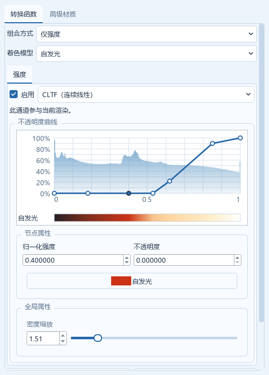

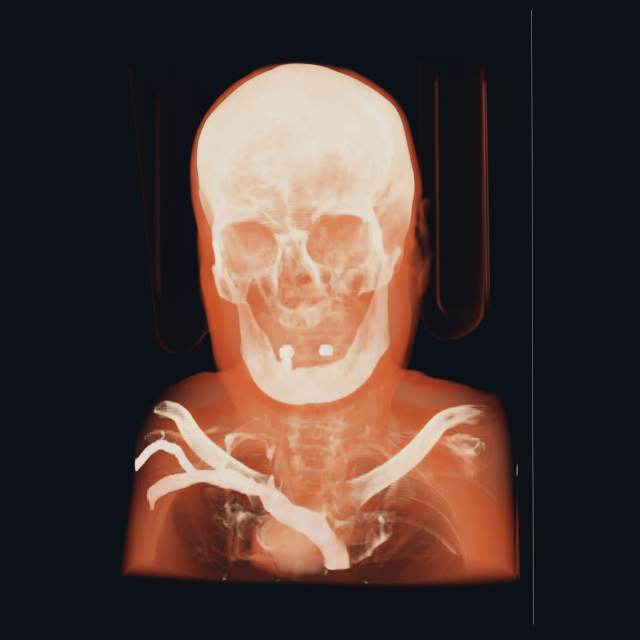

调整前。0.40 处不透明度 0.11，颈肩软组织可见。640×640，2048 SPP。

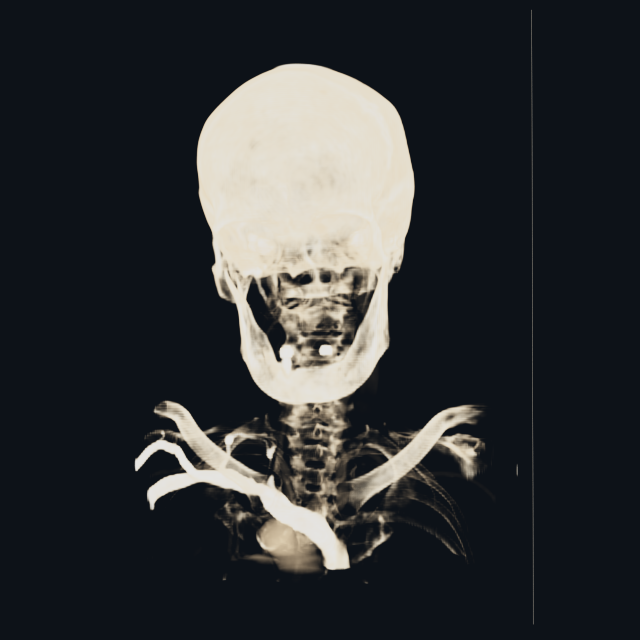

调整后。只把该点不透明度改为 0，颈肩外层退去。640×640，2048 SPP。

## 用强度和离散掩膜显示同一体数据 

沿用 RC 中 BraTS_MEN-EA-Mask1_2DSLTF-Scene.xml 的强度、Mask1、空间变换与视角方向。原 Demo 的 Mask1 采用连续曲线；下面练习对真实整数标签做精确选择。主强度和 Mask1 共同参与同一幅图。这里每个通道各有一个一维函数，再将结果组合，区别于高级材质中的“强度 × 梯度”网格。

1. 打开 `02-dptf-before.xml`，或从原 Demo 的私有副本准备通道。强度保留 Float 数据源、目标 UShort、三线性；原始强度窗口 0–3000。原始 Mask1 是 UShort，检查到的非零标签恰为 500、600、700。要保留它们，在 XML 对应的 Mask1 DataFile 设置 valueDomain="StorageRange"、reassignMaskValues="0"、interpolation="Nearest"，在 DataAimFormat 设置 Mask1="UShort"，ReAssignValue 的 Mask1 也为 "0"；关闭并重新打开副本。练习 XML 已配置好这些属性。已有标签高于 255 时不能选 UChar。对应数据都保留 214 × 214 × 138 的源网格，沿用排列 0,2,1。

2. “数据映射 → 转换函数”选择“启用通道相乘”和“自发光”，确认“强度”“掩膜 1”都启用。强度仍为 CLTF。按上章的加点方法填入 (0,0)、(0.15,0.04)、(0.50,0.30)、(1,0.66)；这四个点的自发光依次是灰色 (204,204,204)、(217,217,217)、白、白。强度和掩膜的全局密度缩放都设为 1。现在强度提供标签内的明暗变化。

3. 点“掩膜 1”，类型选“DPTF（离散标签）”。下拉选择“背景（标签 0）”，不透明度填 0；“默认材质（非零标签）”也填 0。未列出的标签将透明。数值框中输入 500，点“添加标签”，再用相同方法添加 600、700。用于添加的数值框和选择已建条目的下拉框是两个控件。务必在上方下拉框确认当前 ID，再编辑色块或不透明度。

4. 在掩膜条目上点“自发光 → 选择颜色”，设置 500 为蓝绿 (15,145,207)，不透明度 1；600 为琥珀橙 (212,71,10)，不透明度 0；700 为红 (194,15,46)，不透明度 1。条目密度缩放都设为 1。这里使用自发光模式，灰色的“漫反射”“镜面反射”等色块当前不参与成像。固定相机平移 (2,-1,32)，透视 FOV 29，曝光 0.63。

5. 调整前只显示 500 和 700。选择标签 600，将其不透明度从 0 改为 0.90，观察新出现的金橙区域。

6. 编辑没反应时，先看“此通道参与当前渲染”提示。“仅强度”会忽略掩膜； 如果 DPTF 类型不可选，检查 Mask 目标格式、最近邻、存储范围和重编号；如果全部消失，检查未知标签、背景和所有实际 ID 是否全被设为 0。XML 或映射 JSON 可保存离散表，普通 TXT 曲线无法表达这些条目。

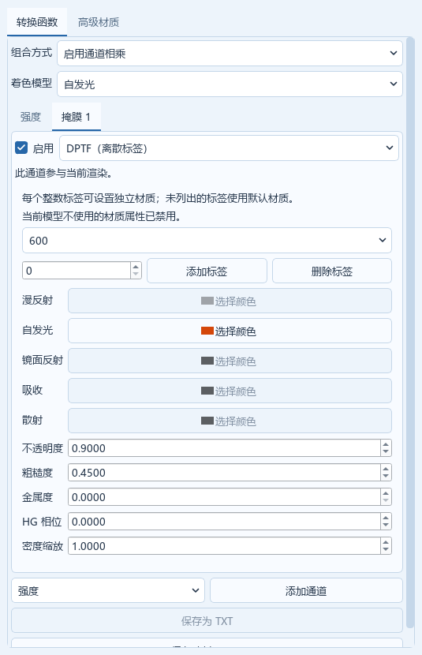

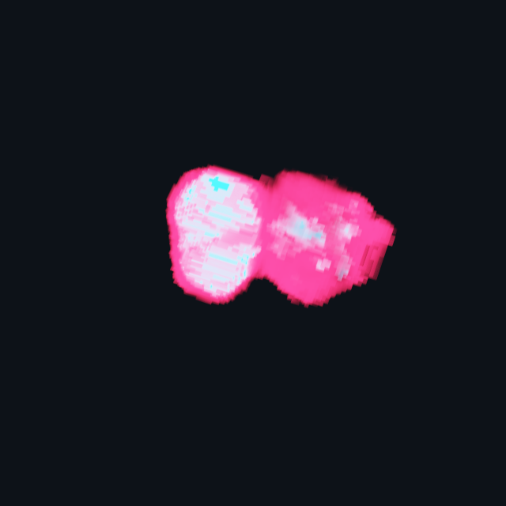

调整前。标签 600 透明，640×640，2048 SPP。

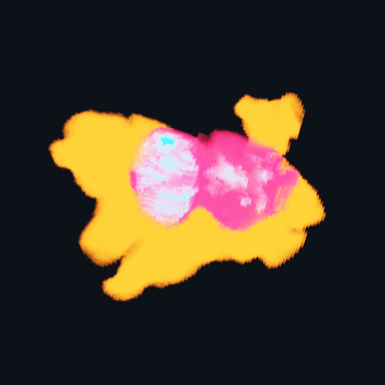

调整后。只有 600 条目的不透明度改为 0.90，640×640，2048 SPP。

## 进阶练习 用强度和梯度区分边缘 

1. 在一个强度变化清楚的体数据副本上，打开「高级材质」，加载「标量—梯度二维材质」配方，目标选 RayCasting / Normal，光学契约用「渲染器属性」。加载配方会重置当前草稿，先保存要保留的设置。

2. 展开二维表。内置配方是 2×2，顺序为左下、右下、左上、右上。按这个顺序查看四个材质绑定，分别为空、foliage、空、gold。横轴从低到高强度，纵轴取归一化梯度幅值除以梯度尺度，再限到表的范围。内部点按邻近格点插值。

3. 先把右上也填成 foliage，验证并应用。然后只把右上换回 gold。比较同一处高强度区域的内部和边缘，观察颜色是否随边缘强度变化。提高「梯度尺度」会把给定梯度推向表的低梯度行。若微小噪点也着色，就从这个参数和高梯度行的颜色对比开始调整。

4. 这个表适合连续混合外观。要让光线在穿过一个确定的材质界面时切换表面模型，使用「材质界面」及标量区间或精确标签。光线投射的材质界面使用 RayCasting / Normal；风格图使用 CUDA NPR；蜡和玉的介电配方使用 SVPT / Normal。高级材质会在应用时检查渲染器兼容性。体光子映射目前没有可调用的实现。

## 用同一套表面与体路径追踪做出三种材质 

### 先找到要编辑的那一层 

1. 在 Crystal 起始窗口打开「示例 → 运行表面与体路径追踪（SVPT）示例」。双击「蜡烛」「虫珀」或「玉兔」。渲染窗口左侧点「数据映射 → 高级材质」。初次练习请沿用示例自带的镜头、环境光和场景单位，这样可以逐步对照下图。

2. 树的左列是「组件」，右列是「值」。展开「材质库 → 0 → 光学参数」。展开「吸收」或「散射」后，有三个可编辑的数字。序号 0、1、2 依次对应线性 R、G、B。逐个编辑数字，每次按 Enter 结束输入，改完一组三个值后点「验证并应用」。现成示例可选择「沿用当前渲染器和模式」。

3. 自己从配方搭建时，在「高级材质」上方选择「表面与体介电材质」，点「载入预设」，然后选择目标「表面与体路径追踪 / 标准」。此操作会替换草稿内容，已有示例应先保存自己的副本。打开「分类方式」确认「一维标量材质」，「光学契约」确认「表面与体光传输」。预设会建好一个材质和两个标量端点，两端的「材质 ID」都应与材质库里同一个稳定 ID 一致。新配方可保留预设的 dielectric ID，按下表改变光学参数即可。点「验证并应用」后保存场景 XML，材质随场景一起保存。

4. 在渲染器设置的「表面与体渲染」中检查「表面等值阈值」为 0.5。这三个示例的强度场描述封闭外形。表面的粗糙度和折射率控制边界上的反射与透射，内层的吸收和散射控制光穿过物体时的颜色变化。吸收和散射都是每单位世界长度的系数。练习时把密度缩放固定在 1，保留示例体素间距；相同参数用在尺寸差异很大的物体上，会产生不同的透光程度。示例使用 RGB 胶片、环境贴图照明。

5. 对每一组数字，等累计 SPP 走到 2048 再观察。修改参数后累计会重新开始。下列各组仅改一个 RGB 属性；同组两张图沿用同一个示例的镜头、光照、体数据、地面、曝光和材质其他设置。

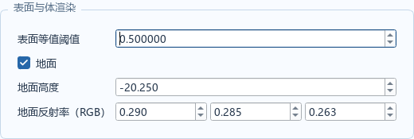

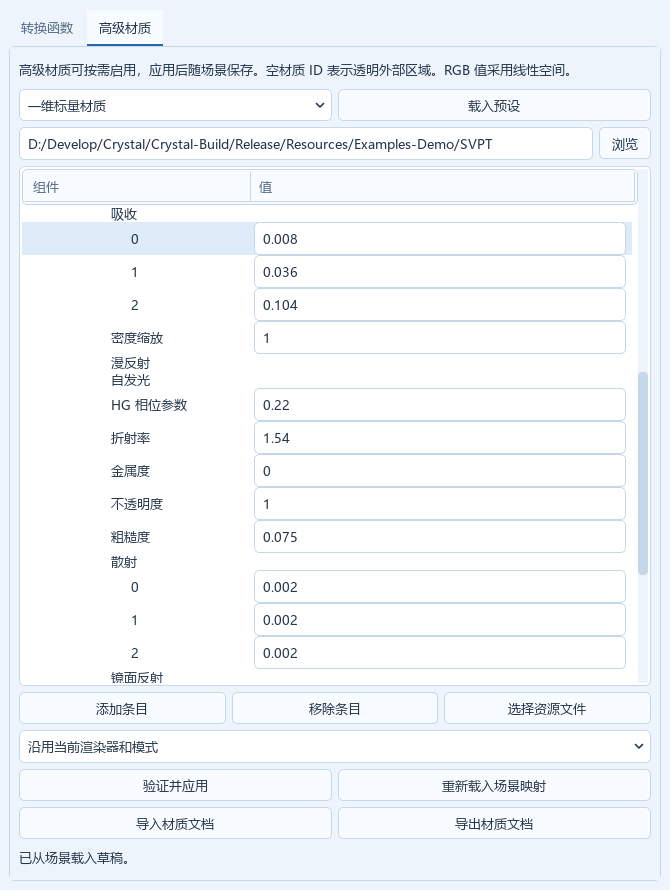

### 用散射做出象牙蜡 

1. 打开「蜡烛」（Candle-SVPT-Scene.xml）。模型是体素化的柱形蜡块，顶部有浅凹；本练习展示蜡料本身。示例材质库中材质名为 Ivory wax、ID 为 wax。

2. 在「光学参数」里填好「吸收」(0.003, 0.011, 0.032)，「粗糙度」0.22，「折射率」1.44，「HG 相位参数」0.20，保留「密度缩放」1。在「散射」里先输入 (0.01, 0.01, 0.01)，验证并应用。看底部靠左投进来的亮带，局部很亮，而更厚的部分呈琥珀色。

3. 只把「散射」改为 (0.59, 0.60, 0.61)，再应用。顶部与左侧亮面变成较宽的奶油色渐变，底部刺眼的亮带减弱，仍可从明暗分布辨认柱体转折。三个散射通道很接近，暖色主要来自对短波通道较强的吸收。

4. 要制作自己的乳白或略透明蜡，可把三个散射值一起向前一组降低一半，每次应用后先看底缘和顶口，再决定是否继续。若蜡料颜色过黄，可略减蓝通道吸收，同时保留照明和曝光，便于判断材料色。

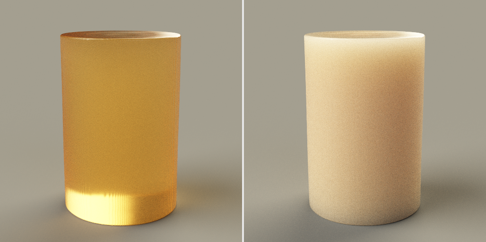

左侧为弱散射，右侧为象牙蜡。每幅原图 512×512，各累计 2048 SPP。

### BugNIST 丽蝇虫珀 · 分别调节金色树脂和虫体 

1. 打开「示例 → 运行表面与体路径追踪（SVPT）示例 → 虫珀」，也可以打开练习包的 **04-amber-before.xml**。使用 SVPT 的标准模式、RGB 成像和环境光。Intensity（`amber-nodule.inforaw`）的 0.5 等值面定义不规则树脂外形和三道通向外部的裂隙。Mask1（`amber-bugnist-blowfly.inforaw`）保存一只真实丽蝇的配准浓度。两个通道共用 189 × 163 × 99 网格，模型间距 0.30 mm。以 `Resources` 为根，场景位于 `Examples-Demo/SVPT`，两份体数据位于 `SceneGeometry-Demo/VolumeData/SVPT/Amber`。

2. 打开「数据映射 → 高级材质」，可以直接编辑现有场景。要恢复示例的光学配方，选择「BugNIST 丽蝇虫珀」，点「载入预设」生成草稿，再点「验证并应用」更新渲染。「虫珀调节指南」可直达对应的帮助章节。使用这套配方的场景需要有配准的 Mask1。标量端点 0 和 1 都选用 `amber`，不透明度乘数均为 1。

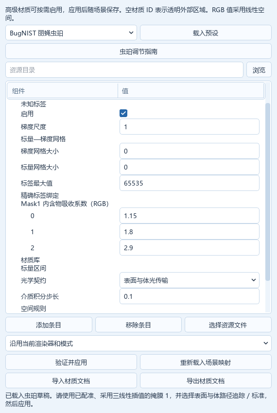

3. 在材质库第 0 项 **Golden fossil amber** 中，把吸收 RGB 设为 **(0.008, 0.036, 0.104)**，散射 RGB 设为 **(0.002, 0.002, 0.002)**。密度缩放取 **1**，粗糙度 **0.075**，折射率 **1.54**，HG 相位参数 **0.22**，金属度 **0**，不透明度 **1**。蓝光衰减最快，所以树脂越厚，透过的光越偏金黄。粗糙度影响高光的宽度；提高散射会使虫体更难看清。

4. 回到材质树根层，展开「Mask1 内含物吸收系数（RGB）」。先填 **(0, 0, 0)**，点「验证并应用」，等到 2048 SPP，观察中央透光和边缘的裂口。保持相机与灯光固定，把同一项改为一半 **(0.575, 0.90, 1.45)**，再改为全量 **(1.15, 1.80, 2.90)**，每次都验证并应用。先看胸腹颜色，再看薄翅边缘。三张图中的裂隙可作定位参照。

下图是根层三个局部吸收分量的输入位置。只想加深丽蝇时，在这里调节。材质库中的基底吸收负责整块树脂的颜色。

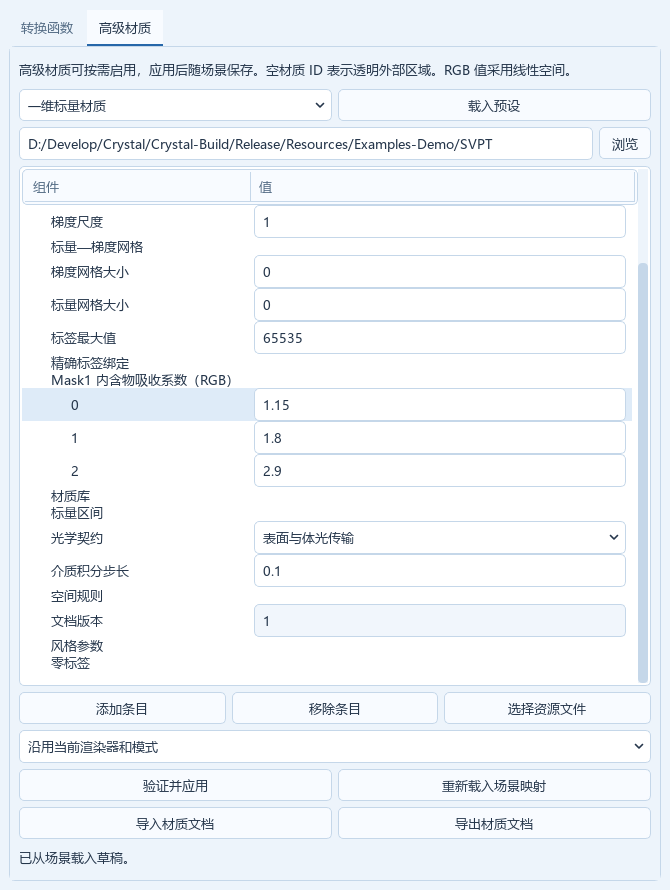

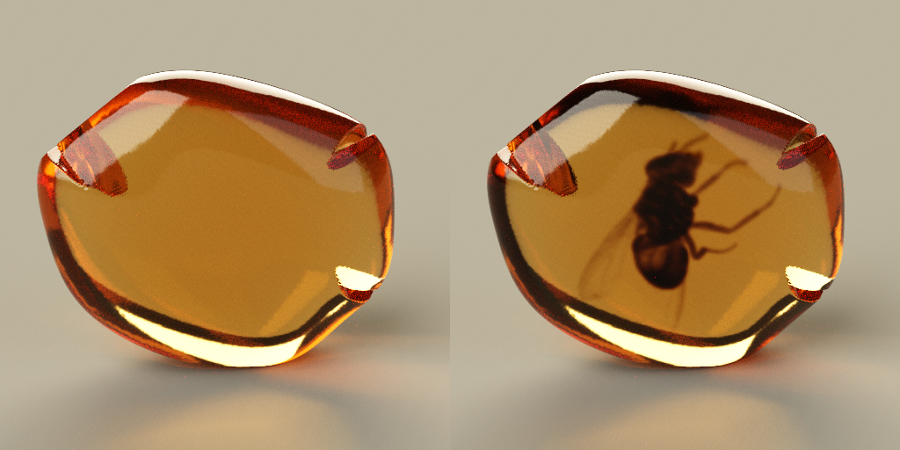

**关闭与全量。** 左图关闭虫体吸收，右图使用全量。两幅均为 512 × 512，各实际累计 2048 SPP。对照胸部、细足和翅膜。裂口属于树脂表面，在两幅图里都清晰可见。

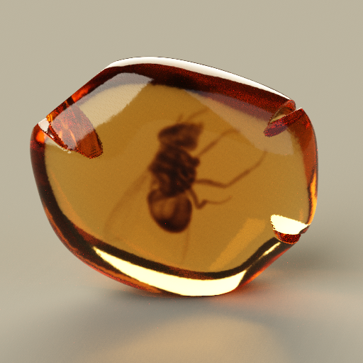

**半量。** 和全量图比较，注意腹部透过了多少光。薄翅在两幅图里都比厚躯干更透亮。

5. **为什么这两处可以分开调？** 光路进入树脂后，局部吸收随采样到的虫体浓度增加。对某一颜色通道，虫体给原有透射率再乘一个因子 `exp(−k_c × ∫ m(s) ds)`。其中 `m` 是三线性插值得到的浓度，`s` 是沿光路的距离，`k_c` 是根层相应颜色的吸收系数。举例来说，当沿光路的浓度积分为 1，只计算这个因子，绿色在半量时约透过 41%，全量时约透过 17%。胸腹较厚，沿途累积更多吸收；翅膜较薄，仍能透光。

6. **排查和保存。** 如果整块琥珀一起变暗，检查是否改到了材质库的基底吸收。如果看不见虫子或虫体偏移，检查 Mask1 与 Intensity 的配准、三线性采样、UChar 原始浓度和根层系数。这个示例按构图缩放了虫体；改变模型尺寸后，需要按照新的光程重新调节。应用满意后保存场景 XML。示例标本编号为 `spy_1_040`。[BugNIST 数据集](https://abdahl.github.io/bugnist/) · [原论文](https://doi.org/10.1007/978-3-031-73411-3_2)

### 用选择性吸收做出青玉 

1. 打开「玉兔」（Jade-Bunny-SVPT-Scene.xml）。jade-bunny.inforaw 由封闭的 bunny 表面网格体素化得到。示例材质名 Celadon jade，ID 为 jade。

2. 在「光学参数」里输入「散射」(0.22, 0.25, 0.225)、「粗糙度」0.37、「折射率」1.61、「HG 相位参数」0.32、密度缩放 1。先把「吸收」的三个通道都设为 0.044，应用。此时耳缘保留浅色透光、身躯呈偏灰的暖色，可用来判断整体造型与曝光。

3. 保持 B 在 0.044，把 R 提高到 0.070、G 降低到 0.027，应用。保留下来的绿光增加，身躯更明显地呈青绿，沿耳朵和背部轮廓仍有浅色反光。对比时看躯干的中间调，同时看耳缘的亮度，可区分材料内部的色偏与环境高光。

4. 自己配更浅的玉色时，将 R、G 两个吸收值各向 0.044 靠拢；调整表面抛光程度可单独改粗糙度。两次操作分开应用，前者主要改变穿过内部的颜色，后者改变反射与透射方向的分布。

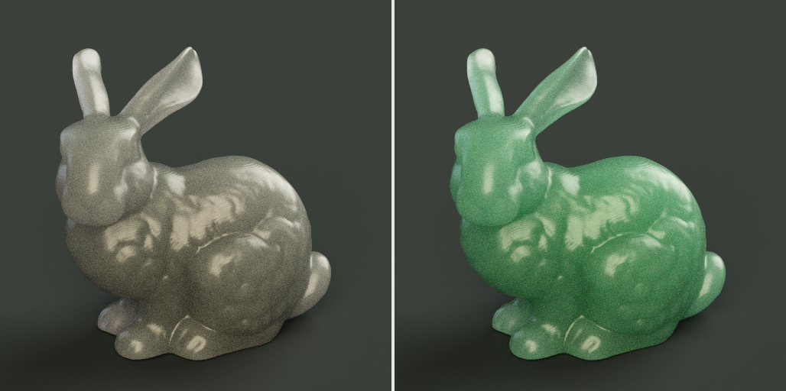

左侧各通道吸收相同，右侧更少地吸收绿光。每幅原图 512×512，各累计 2048 SPP。

### 无法复现时先看哪里 

- 调过数字后画面没有重新累计：确认编辑的是「高级材质」的同一个草稿，点「验证并应用」，查看按钮下方的错误路径。误载入其他配方时，用「重新载入场景映射」取回已应用内容。

- 切到 SVPT 后校验报错：此路径只接受一个 GGX 介电材质、连续标量的两个端点，且使用 RGB 胶片、标准模式和环境光。三个示例的金属度是 0、自发光是 (0,0,0)、不透明度是 1。要呈现透明树脂，请调低吸收和散射。

- 昆虫消失且裂隙仍在：先核对 Mask1 路径、对齐、数值重排，再检查根节点的 Mask1 内含物吸收系数。蜡烛和玉兔只需一个强度体数据。

- 新模型比示例深暗许多：先核对体素间距与物体厚度。固定相机和曝光，先把吸收或密度缩放降低一半对照，待厚薄部位都能辨认后再微调色相。

## 给强度相似的圣诞挂饰分色 

以 Christmas_tree-02.xml 和同目录的 christmas_tree_512x499x512_uint16.inforaw 为起点。场景只载入一个强度体。先另存为练习副本，在成像设置中启用 SPP 上限并输入 2048。原 XML 指定 1，须手工覆盖。保持透视、曝光 0.9、视场 29° 和原视角，方便比较。体强度窗口固定在 0–4095；12 位 CT 装在 uint16 容器中。保留轴置换 (0,2,1)、翻转 (0,0,0) 和原体边界。下文所有 RGB 都是线性值，所有盒坐标都是轴变换后的全体积归一化三维坐标，旋转相机时会跟随模型。

1. 在「数据映射 → 高级材质」展开「材质库」。点亮「启用」，分类方式选「一维标量材质」。原文件已有下面的材质；从空白开始时可用「添加条目」，填写稳定 ID 和表中数值。「名称」可以用中文，节点和规则里须填稳定 ID。五种材质的镜面色均为 (0.04,0.04,0.04)，吸收、散射、发射均为零。初次练习保留三盏原有方向光。

2. 先做可快速预览的练习。目标渲染器选 RayCasting / Normal，光学契约选「渲染器属性」。移除「有向材质界面」下原有六项和「空间规则」下原有五项，打开「渲染器设置」里的梯度明暗。将 foliage 的不透明度设为 0.28，其余设为 1。展开「标量区间」写入下列六行，所有不透明度乘数为 1。0 → 空 ID，0.0193 → 空，0.0200 → foliage，0.100 → foliage，0.159 → metal，1 → metal。点「验证并应用」。树应显出绿色针叶、金色树顶和数颗同色挂饰。透明平台使空气无色；若只有 0 与 0.020 两个节点，线性插值会让空气也产生不透明度，遮住整棵树。

3. 在「空间规则」选中集合，点「添加条目」，展开 0，按下表从第一行开始添加。每条的组合方式选「替换外观」，最大标量 1，不透明度乘数 1。初次试用最小标量 0.053724（220/4095）。三维最小、最大位置下沿 0、1、2 顺序填 XYZ。先只做第一条并「验证并应用」，旋转观察左侧区域挂饰颜色，再补余下四条。规则只更改外观；重叠时后添加的规则覆盖前项。设置错时用「重新载入场景映射」丢弃此次尚未应用的草稿。

4. 和基线对照，部分枝条也落在同一盒与密度范围内。把五条规则的最小标量统一提高到 0.158730（650/4095），再应用，看哪些枝条变回绿色。若薄壳饰物上出现双色条纹，说明同一挂饰穿过了标量或空间边界。缩小盒子、逐件绑定 Mask，或使用本手册配套 Demo 的强度 × 标签方法。增加 SPP 可以减少颗粒，无法纠正分类。

5. 记录完三张对照后保存场景。已应用的高级材质会嵌入 XML 的 MappingDocument。Import/Export material document 可搬运同一组映射。导入先进入草稿，须再次验证并应用。

| 材质 ID | 表面 | 漫反射 RGB | 粗糙度 | 金属度 |
|---|---|---|---:|---:|
| foliage | Lambert | 0.060, 0.180, 0.018 | 0.80 | 0 |
| metal | GGX | 0.950, 0.650, 0.230 | 0.25 | 0.85 |
| red | GGX | 0.550, 0.008, 0.018 | 0.22 | 0.60 |
| blue | GGX | 0.008, 0.035, 0.500 | 0.22 | 0.60 |
| purple | GGX | 0.240, 0.006, 0.150 | 0.22 | 0.60 |

| 顺序 | 最小 XYZ | 最大 XYZ | 材质 ID |
|---|---|---|---|
| 0 | 0.15, 0.12, 0.12 | 0.43, 0.44, 0.85 | red |
| 1 | 0.52, 0.15, 0.12 | 0.84, 0.48, 0.85 | blue |
| 2 | 0.32, 0.35, 0.12 | 0.64, 0.62, 0.85 | purple |
| 3 | 0.55, 0.50, 0.12 | 0.85, 0.78, 0.85 | red |
| 4 | 0.16, 0.53, 0.12 | 0.44, 0.78, 0.85 | blue |

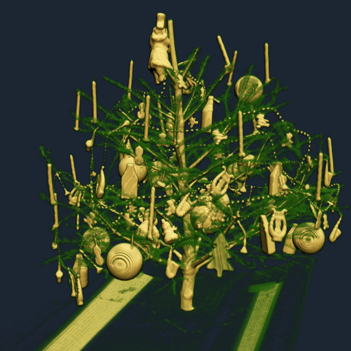

A　仅用强度分类。

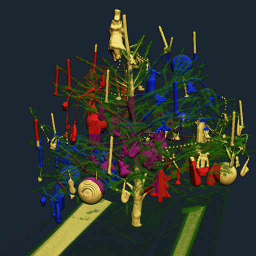

B　加入五个覆盖区域，起始强度 220/4095。

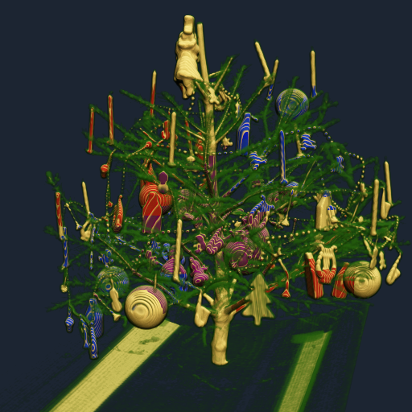

C　将门槛收紧到 650/4095，观察针叶和薄壳彩球。三图相机相同，均为 512×512、2048 SPP。

### 复现原场景的物理材质界面 

保留同一材质表，将 foliage 不透明度恢复为 1，光学契约改为「材质界面」，目标仍为 RayCasting / Normal。把标量区间恢复为四行 0 → 空，0.019536（80/4095）→ foliage，0.158730（650/4095）→ metal，1 → metal。材质界面按区间切换 ID，≥80 命中 foliage，≥650 命中 metal。恢复五个框及其 220/4095 起点。展开「有向材质界面」列表，每对都录入正、反两个方向：空 ↔ foliage，用 foliage 表面材质，单次穿越覆盖率 0.40；空 ↔ metal，用 metal、覆盖率 1；foliage ↔ metal，用 metal、覆盖率 1。空 ID 表示外部空间。介质积分步长 0.20，原场景没有参与介质吸收或散射。关闭常规梯度明暗，物理界面积分器自行处理边界照明。点「验证并应用」，检查树叶透叠、树顶高光和背面表面。界面求解会显著慢于上面三幅比较图，原文件 0.75 的体重采样也会影响细针和鬼影。若画面发黑，先看首帧是否完成，再检查空 ↔ foliage 和空 ↔ metal 两对条目、材质 ID、方向光和强度窗。

论文中图 5(a) 与图 14 的做法。Igouchkine、Zhang 和 Ma 用沿三个空间轴递增的辅助体给不同位置的饰物选择不同表面反射外观。作者在图 14 特别说明，这种空间分类能区分强度相近的饰物，但仍可能影响同一区域中的其他结构。要复现「同密度、不同色」的原理，只需强度与位置；若要逐件换色且旁边的叶子保持原色，可用配准的对象标签。该论文的实测反射、插值和光照与这里的 Lambert/GGX 参数各异，本手册图片均由 Crystal 实际计算。[IEEE 原论文](https://doi.org/10.1109/TVCG.2017.2784830) · [原始 CT 采集说明](https://www.cg.tuwien.ac.at/page/xmas/)

## 用内置圣诞树 Demo 给挂饰换色 

在启动器选择 **示例 → 运行光线投射示例 → 彩饰圣诞树**。这个场景随程序提供。两份体数据合计约 16.2 MiB，网格均为 320×312×320。场景里的光线投射器使用梯度着色，输出为 1024×1024，采样上限 2048。

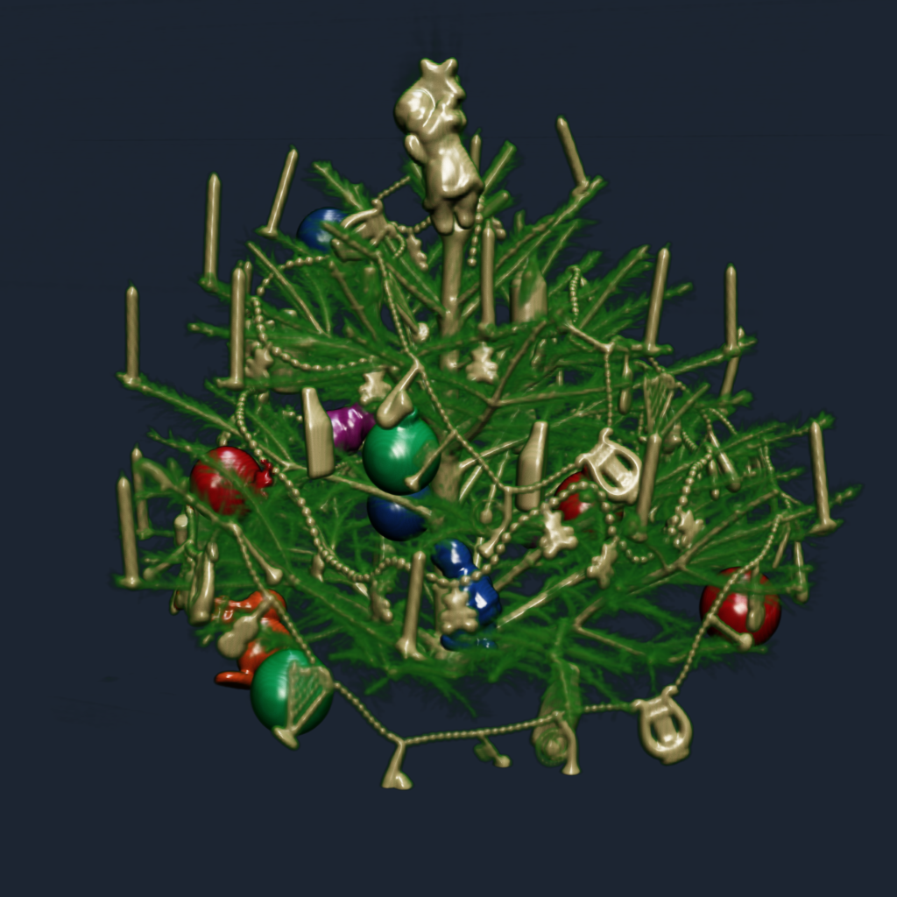

1. 在「数据映射 → 转换函数」，先将「组合方式」临时改成「仅强度」，再切回「启用通道相乘」。可以看到强度 CLTF 负责针叶、树顶和珠链的可见度；打开掩膜后，同样密度的球壳可以独立着色。

2. 打开「掩膜 1」，保持 DPTF，在上方条目框选择 **1**。点击「漫反射」把石榴红换成浅蓝。只有绑定到该标签的挂饰随之换色。保留不透明度 1 和白色镜面反射，确认金色珠链和绿色前景没有跟着变蓝。下表是示例中的线性 RGB，颜色选择器显示的 8 位分量约为对应值乘以 255。

3. 回到「强度」页。窗宽为 0–4095，原值 73 对应横轴 0.01783，默认不透明度 0.243。可试降到 0.135，留意中央绿球前的细枝会怎样变化，再恢复。标签 6 的不透明度从 0 改为 1 则会显示扫描支架所在的底部区域。

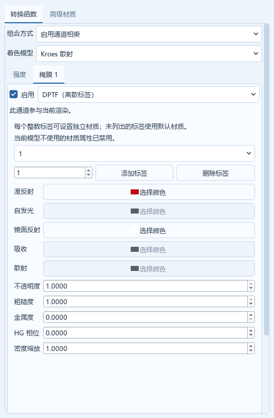

| 标签 | 初始漫反射 RGB | 用途 |
| --- | --- | --- |
| 0 | 1, 1, 1 | 保留强度层的枝叶与珠链颜色 |
| 1 | 0.74, 0.032, 0.061 | 石榴红 |
| 2 | 0.045, 0.19, 0.92 | 钴蓝 |
| 3 | 0.029, 0.73, 0.54 | 青绿 |
| 4 | 0.49, 0.070, 0.73 | 紫晶 |
| 5 | 0.99, 0.23, 0.105 | 珊瑚色 |
| 6 | 1, 1, 1 | 支架所在底部区域，默认不透明度 0 |

### 在 1024 图像上检查渗色 

下面两次渲染只替换了赋色用的掩膜，均在相同的精简 CT、光照、相机和 2048 SPP 下完成。对照图左列使用五个带强度门槛的位置框，右列使用与挂饰配准的对象标签。每格都是 264×194 个原始像素。

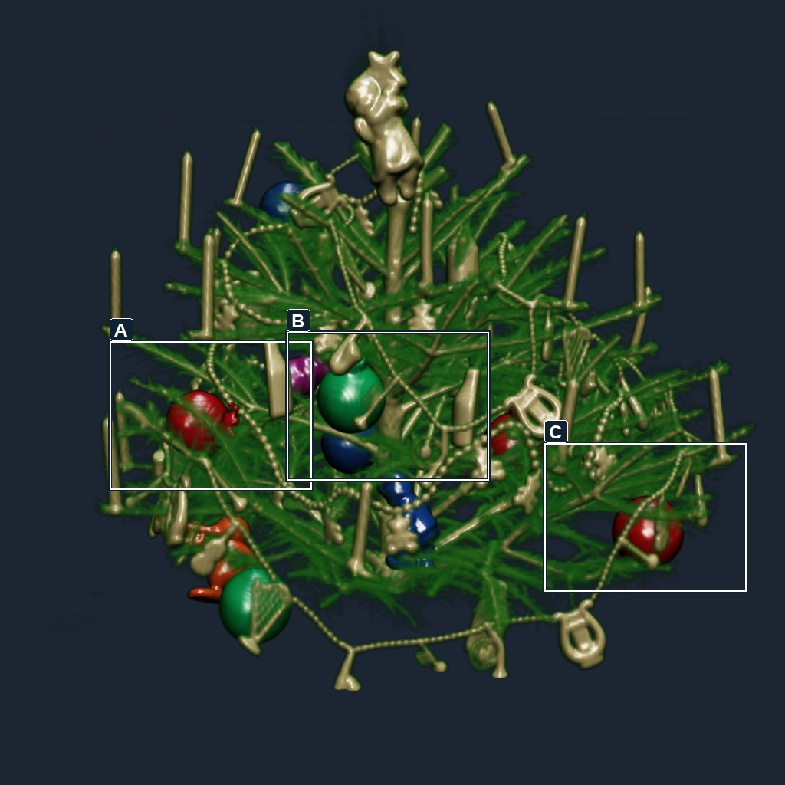

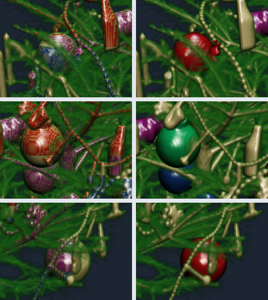

**A，左侧红球。** 顺着前方的一根绿枝看过去，调整后球壳保持红色，枝条保持绿色，旁边的珠链仍是金色。**B，中央绿球。** 原来的阶梯状红斑消退，能看清局部高光和后方的蓝球。**C，右下红球。** 前景枝条横过球壳，在交界处仍能分清两者。少数高光保留轻微的扫描纹理；降采样后的最细针叶仍显得柔和。

从自己的 CT 做同类效果时，先预滤波连续强度，再降采样；掩膜和强度共用网格与轴变换。这个例子在滤波副本上取原值至少 320 的六邻接连通域，保留体素数至少 2500、各方向包围盒跨度 18–55 格的 11 件装饰。在配色掩膜中把它们的支持区域向外延伸最多 3 格，让色界尽量落在低不透明度处。强度用三线性插值确定轮廓；掩膜用最近邻保持整数标签。具体大小与阈值只适用于这一组 CT。挂饰颜色为艺术配色。原始扫描署名 Armin Kanitsar，2002。[原始采集说明](https://www.cg.tuwien.ac.at/page/xmas/) · [开放数据来源](https://github.com/InsightSoftwareConsortium/OMEZarrOpenSciVisDatasets#christmas_tree) · [CC BY 4.0](https://creativecommons.org/licenses/by/4.0/)

[English](./Transfer_Function_Handbook.md)
