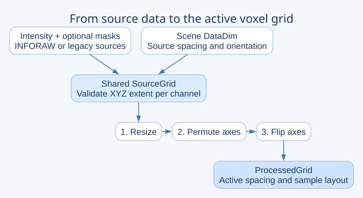

# Volumes and Scenes

[Documentation](./Documentation.md) · [Software Operation](./Software_Operation.md) · [Datasets](./Datasets.md)

A volume asset stores a sampled grid. A scene binds one Intensity volume, optional masks, source-axis geometry, a camera, lighting and a material mapping. Saving a scene lets you reopen the same rendering configuration.

## Choose an input format

| Input | What you need | Workflow |
| --- | --- | --- |
| INFORAW | One `.inforaw` per scalar channel | Open directly from the GUI, or use it as a typed scene source. |
| INFO + RAW | Descriptor, payload, source resolution, scalar type and byte order | Open a compatible legacy descriptor, or convert the original payload into INFORAW. |
| Headerless RAW | Independently known dimensions, scalar type, byte order and header offset | Convert with explicit metadata before import. |
| DICOM series | A series directory and, for a multi-series directory, the required series UID | Prepare INFORAW with the [independent Python tool](#prepare-a-dicom-series), then open the result. |
| Existing Crystal XML/JSON | Scene and its referenced assets | Open with **Run Scene XML** or **Run Scene Json**. |

### What is inside INFORAW?

Each version 1 file contains a readable UTF-8 header ending with `END_HEADER`, followed by one zlib stream of little-endian scalar voxels. The header records the XYZ resolution, spacing and units, scalar type, uncompressed byte count and CRC32. Comment lines beginning with `#` can retain a public source URL, specimen and license. Each channel is separate. Orientation and display settings are stored by the scene.

An INFORAW header can be inspected alone, but checking the grid, geometry and full compressed stream gives stronger verification. A small disk size still requires memory for the expanded voxels and active rendering resources.

## Example 1. Convert a RAW volume and reopen it

The example assumes the input was independently documented as little-endian unsigned 16-bit, X fastest, with a shape of `256 × 256 × 128` and spacing of `(0.2,0.2,0.4) mm`. It should contain exactly `16,777,216` data bytes. Replace sample paths and geometry with those of your own scan.

```powershell
$converter = "D:/Develop/Crystal/Crystal/Support/PyScripts/convert_volume_to_inforaw.py"
$asset = "D:/VolumeProjects/specimen/specimen.inforaw"
python -B $converter "D:/VolumeProjects/specimen/specimen.raw" `
  --input-format raw --output $asset `
  --resolution 256 256 128 --dataformat ushort --input-byteorder little `
  --spacing 0.2 0.2 0.4 --spacing-unit mm
python -B $converter --verify $asset
```

For published scan provenance, add `--comment "Source: <original download URL>"` during conversion. If physical spacing is unknown, use `--spacing-unit voxel` and enter the known grid ratio, or `1 1 1` when no ratio is available.

1. Wait for verification to complete and confirm the reported shape, type and units.
2. Open the resulting asset from **Run NS using Raw**. Save the scene after adjusting its transfer function.
3. Reopen the saved XML and check the displayed sample, geometry and active spacing against the first session.

### Prepare a DICOM series

Use the source-tree `requirements-dicom.txt` in your Python environment and run the preparation tool. Use the series UID if the input folder contains more than one series. Verify the output with the same INFORAW command above before opening it in Crystal.

```powershell
$prepare = "D:/Develop/Crystal/Crystal/Support/PyScripts/prepare_dicom.py"
python -B $prepare "D:/VolumeProjects/source-series" `
  --output "D:/VolumeProjects/specimen/specimen.inforaw"
```

## Source grid and processed grid



*Figure 1. A shared loading plan builds the processed grid from all registered source channels. The scene stores the original source-axis dimensions and spacing.*

- **SourceGrid** uses the file dimensions and axes. All source files for the scene must agree per axis. Equal voxel counts alone are insufficient.
- **ProcessedGrid** is the runtime layout after **resize → permute → flip**. In-memory mask replacement follows the active processed grid. Disk masks use the source grid.
- `DataDim.VoxelSpacing` in the scene has precedence over file metadata. **Spacing scale** is applied once, optional spacing recalculation compensates for resize, then axis permutation reorders spacing. Flips change direction and keep the spacing magnitude.

## Example 2. Set spacing and apply a manual window

1. Open **Volume Settings → Scene volume settings**. Enter **Voxel spacing X/Y/Z** for the original axes. For `0.2,0.2,0.4` with a spacing scale of `1` and no orientation or resizing, expect `Active voxel spacing: 0.2,0.2,0.4`.
2. Clear **Automatic intensity range**. Enter a minimum and maximum in original sample values. For a signed source, try `-500` and `1500` as an illustrative window. The appropriate range depends on the scan.
3. Click **Apply volume settings**. The viewport reloads its volume. **Data Present** shows the stored window, which can differ numerically from the values you entered when the storage type changes.
4. Look at the Intensity histogram and [CLTF](./Mapping_and_Segmentation.md#example-1-refine-the-intensity-curve). With the window above, source values `-1000, 0, 1000, 3000` correspond to normalized `0, 0.25, 0.75, 1`.
5. Save and reopen the scene. Check the effective spacing and window. The scene records overrides, and the asset retains its original metadata.

The packaged Manix NS scene illustrates why a manual window matters. Its `[-2000,4000]` range limits the influence of very high edge voxels on the intensity histogram. Mask label IDs remain independent of the intensity window.

## Path resolution

| Scene path mode | Resolution |
| --- | --- |
| `Absolute` | Uses the full specified file path. Useful for shared assets that stay in one location. |
| `Demo` | Resolves to a packaged example resource. |
| `SceneFile` | Resolves explicitly from the directory of the scene file. Keep scene and assets together when moving them. |

Example XML fragment inside `MedicalVolumeData`. This binds a continuous volume and an optional categorical mask that share the same XYZ dimensions.

```xml
<DataFile fileType="inforaw" filePath="intensity.inforaw" pathType="SceneFile"
          type="Intensity" interpolation="TriLinear"/>
<DataFile fileType="inforaw" filePath="mask.inforaw" pathType="SceneFile"
          type="Mask1" interpolation="Nearest" valueDomain="StorageRange"
          reassignMaskValues="0"/>
<DataDim Resolution="256,256,128" VoxelSpacing="0.2,0.2,0.4"
         SpacingUnit="mm" SpacingScale="1"/>
```

When the model appears stretched, verify the scene’s explicit source-axis spacing, scale, orientation and resize settings. When a mask is offset, verify its source orientation as well as its resolution. For a blank or faint volume, check the source window and the opacity curve together.
