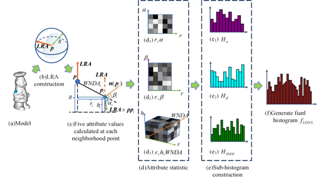
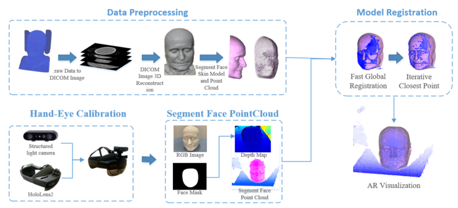
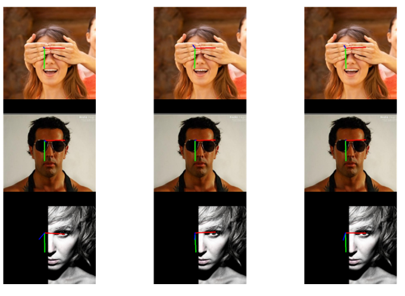
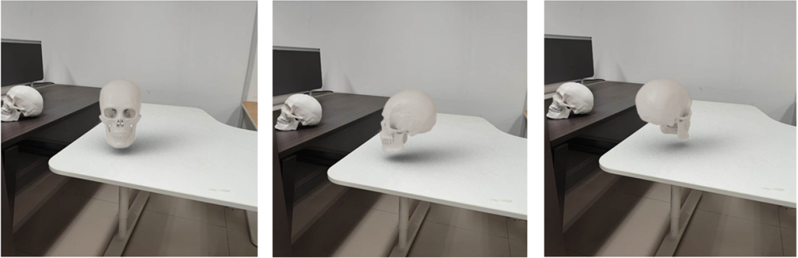

<ProfileHeader member="Chunxiao_Xu" language="en" />

<strong>Dr. Xu is the founder and core algorithm contributor of the Crystal medical visualization platform. He has long been dedicated to applying cutting-edge medical imaging visualization technologies in clinical practice and advancing their meaningful impact in scientific research. At the same time, he strives to present medical visualization in a more artistic way, hoping to bridge the gap between doctors and patients and foster greater understanding and trust.</strong>

## Biography

  
In 2019, I obtained a Bachelor’s degree in Engineering from Shandong University (SDU) and was subsequently admitted to the University of Science and Technology of China (USTC) to pursue a major in Electronic Information the same year. In 2021, I transitioned to a combined master’s and doctoral program, focusing on computer graphics and 3D visualization.

  

  
My research interests span realistic rendering, artificial intelligence, neural rendering and inverse rendering, and 3D visualization. My personal project,  <a href="https://medical-vis.com/" target="_blank">Crystal</a> , represents the culmination of my work in the field, aiming to create a cutting-edge and stylish medical visualization engine. The project is now taking shape, so stay tuned!  

  

  
In addition to focusing on personal research, I also emphasize the knowledge sharing. On my personal tech sharing website <a href="https://dezeming.top" target="_blank">dezeming.top</a> , I have written hundreds of articles on principles and algorithm implementations, building a comprehensive learning system for realistic rendering research. This work has received widespread acclaim and support from learners.

 

<CardGrid>
  <Card title="Project Website" icon="line-md:text-box-to-text-box-multiple-transition">
    <a href="https://medical-vis.com/" title="Dezeming-Medical Visualization">
      Dezeming-Medical Visualization
    </a>
  </Card>

  <Card title="Technology Sharing Website" icon="line-md:text-box-to-text-box-multiple-transition">
    <a href="https://dezeming.top/" title="Dezeming Family">
      Dezeming Family-Everything is worth researching
    </a>
  </Card>
</CardGrid>

 

::: center
### Demo Video
:::

---
 

- [Volume rendering 1](/videos/Team_Profile/CHUNXIAO_XU/Photorealistic-1.mp4)
- [Volume rendering 2](/videos/Team_Profile/CHUNXIAO_XU/Photorealistic-2.mp4)
- [Volume rendering 3](/videos/Team_Profile/CHUNXIAO_XU/Photorealistic-3.mp4)
- [3D Gaussian splatting 1](/videos/Team_Profile/CHUNXIAO_XU/3DGS-1b.mp4)
- [3D Gaussian splatting 2](/videos/Team_Profile/CHUNXIAO_XU/3DGS-1c.mp4)
- [3D Gaussian splatting 3](/videos/Team_Profile/CHUNXIAO_XU/3DGS-1d.mp4)

 

::: center
### Publications
:::

---

 

<CardGrid>

<Card title="" icon="material-symbols:bookmark-outline">
C. Xu, H. Cheng, Z. Chen, J. Wang, Y. Chen and L. Zhao, "Real-time Realistic Volume Rendering of Consistently High Quality with Dynamic Illumination," in IEEE Transactions on Visualization and Computer Graphics, doi: 10.1109/TVCG.2024.3445339.
</Card>
</CardGrid>
 

---
 
<CardGrid>

<Card title="" icon="material-symbols:bookmark-outline">
C. Xu, X. Xu, J. Zhang, Y. Cao, and L. Zhao. 2025. "Efficient Multi-Material Volume Rendering for Realistic Visualization with Complex Transfer Functions" Journal of Imaging 11, no. 6: 193. https://doi.org/10.3390/jimaging11060193
</Card>
</CardGrid>
 

---
 
<CardGrid>

<Card title="" icon="material-symbols:bookmark-outline">
Xu, X., Xu, C., & Zhao, L. (2025). Real-Time Volume-Rendering Image Denoising Based on Spatiotemporal Weighted Kernel Prediction. Journal of Imaging, 11(4), 126.
</Card>
</CardGrid>
 

---
 
<CardGrid>

<Card title="" icon="material-symbols:bookmark-outline">
Xu, C., Xu, X., Zhang, J., Liu, Y., Cao, Y. and Zhao, L. (2025), Real-time Neural Denoising for Volume Rendering Using Dual-Input Feature Fusion Network. Computer Graphics Forum e70276. https://doi.org/10.1111/cgf.70276
</Card>
</CardGrid>
 

---
 
<CardGrid>

<Card title="" icon="material-symbols:bookmark-outline">
Cheng, H., Xu, C., Wang, J., Chen, Z., & Zhao, L. (2022). Fast and accurate illumination estimation using LDR panoramic images for realistic rendering. IEEE Transactions on Visualization and Computer Graphics, 29(12), 5235-5249.
</Card>
</CardGrid>
 

---
 
<CardGrid>

<Card title="" icon="material-symbols:bookmark-outline">
Jiatian Zhang, Chunxiao Xu, Han Zhong, Yiheng Cao, and Lingxiao Zhao. 2025. "BDFM: Brain Diseases Foundation Model for Segmentation and Classification Tasks", IEEE Transactions on Biomedical Engineering (TBME), doi: 10.1109/TBME.2025.3637146
</Card>
</CardGrid>
 

---
 
<CardGrid>

<Card title="" icon="material-symbols:bookmark-outline">
Zhang, J., Xu, C.(co-first), Xu, X., Zhao, Y., & Zhao, L. (2025). SegR3D: A Multi-Target 3D Visualization System for Realistic Volume Rendering of Meningiomas. Journal of Imaging, 11(7), 216.
</Card>
</CardGrid>
 

---
 
<CardGrid>

<Card title="" icon="material-symbols:bookmark-outline">
Cheng, H., Xu, C.(co-first), Chen, Z., Wang, J., Chen, Y., & Zhao, L. (2023, March). A Mixed Reality Framework for Interactive Realistic Volume Rendering with Dynamic Environment Illumination. In 2023 IEEE Conference on Virtual Reality and 3D User Interfaces Abstracts and Workshops (VRW) (pp. 741-742). IEEE.
</Card>
</CardGrid>
 

---
 
<CardGrid>

<Card title="" icon="material-symbols:bookmark-outline">
Cheng, H., Xu, C., Wang, J., & Zhao, L. (2022, September). Quad‐fisheye Image Stitching for Monoscopic Panorama Reconstruction. In Computer graphics forum (Vol. 41, No. 6, pp. 94-109).
</Card>
</CardGrid>
 

---
 
<CardGrid>

<Card title="" icon="material-symbols:bookmark-outline">
Cheng, H., Xu, C.(co-first), Chen, X., Chen, Z., Wang, J., & Zhao, L. (2023, October). Realistic Volume Rendering with Environment-Synced Illumination in Mixed Reality. In 2023 IEEE International Symposium on Mixed and Augmented Reality Adjunct (ISMAR-Adjunct) (pp. 423-428). IEEE.
</Card>
</CardGrid>
 

---
 
<CardGrid>

<Card title="" icon="material-symbols:bookmark-outline">
LSNFS: A discriminative and robust local feature descriptor
Senda Hong, Haojie Cheng, Chunxiao Xu, Zhenxin Chen, Jiajun Wang and Lingxiao Zhao
Laser & Optoelectronics Progress
</Card>
</CardGrid>
 

---
 
<CardGrid>

<Card title="" icon="material-symbols:bookmark-outline">
An augmented reality navigation system for head surgery using structured-light stereo vision
Xujing Chen, Chunxiao Xu, Yang Li, Haojie Cheng, Jiajun Wang and Lingxiao Zhao
Laser & Optoelectronics Progress
</Card>
</CardGrid>
 

---
 
<CardGrid>

<Card title="" icon="material-symbols:bookmark-outline">
Head pose estimation based on Res2Net and attention mechanisms
Yang Li, Chunxiao Xu and Lingxiao Zhao
Computer & Digital Engineering
</Card>
</CardGrid>
 

---
 
<CardGrid>

<Card title="" icon="material-symbols:bookmark-outline">
Indoor lighting estimation using complementary spherical Gaussian and spherical harmonic features
Weijie Chen, Chunxiao Xu and Lingxiao Zhao
Computer and Modernization
</Card>
</CardGrid>
 

---
 

<Card title="Professional and academic service" icon="mingcute:paper-line">

World UHD Video Industry Alliance (UWA) expert group, working on standards and proposals.

Committee service for Computers &amp; Graphics and IRBM. Peer review for TVCG, MICCAI, ISMAR, JCIT and Array.

</Card>

<Card title="Patents and applications" icon="mingcute:bling-line">

Image processing method, apparatus, device and storage medium (CN121908001A).

Gaussian prediction network training method, apparatus, electronic device and storage medium (CN122049169A).

Depth video generation method, apparatus, device and storage medium (CN122120427A).

Fast multi-view fisheye image and video stitching independent of camera parameters (2022107139471).

Real-time three-dimensional volume rendering of medical imagery under fully dynamic illumination (202510145466).

Construction of a detection model for early gastrointestinal cancer lesions (2025092200364930).

</Card>

<Card title="Personal Honors" icon="mingcute:candy-2-line">

2017 · Shandong University Annual Award for Individual Achievement in Science and Technology Innovation

2018 · Shandong University Annual Award for Individual Achievement in Science and Technology Innovation

2021 · Second Prize, Huawei Cup China Graduate Mathematical Modeling Competition

2019 · National Second Prize, College Student Innovation and Entrepreneurship Program

2018 · First Prize, China Engineering Robot Competition

2017 · Third Place, China Tourism Security Robot Competition

2017 · First Prize, World Robot Contest Technical Challenge

2017 · First Prize, China Undergraduate Biomedical Engineering Innovation Design Competition

</Card>

<card title="Hobbies" icon="mingcute:bike-line">

Piano: Level 10 certificate and performance experience.

Reading: Chinese and international literature and history.

Sport: Distance running and cycling, including half marathons and 100-kilometer rides.

</card>

<ImageCard
  image="/images/Team_Profile/CHUNXIAO_XU/Certificate_of_Honor.png"
  title="Certificate of Honor"
  description=""
  href="/"
  author="Chunxiao Xu"
  date=""
/>
