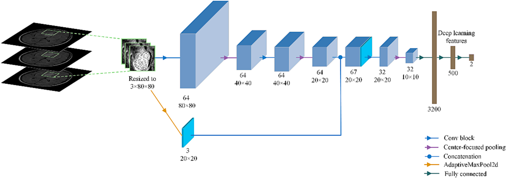
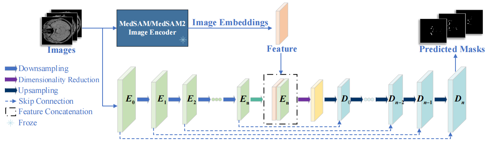
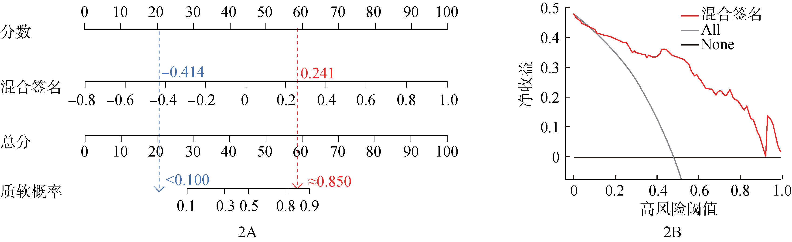

<ProfileHeader member="Jiatian_Zhang" language="zh" />

<strong>张家天博士2020年于山东大学生物医学工程专业本科毕业，保研至中国科学技术大学生物医学工程专业硕博连读，于2026年取得工学博士学位，曾获山东大学优秀毕业生、中国科学技术大学优秀毕业生、校级一等奖学金、校级二等奖学金、工银科灵学子奖学金等荣誉与奖励。</strong>

## 个人简介

张家天博士的研究领域为基于人工智能的医学影像处理与辅助诊断技术，具体围绕着脑膜瘤、脑胶质瘤、脑卒中等脑疾病展开研究。熟练掌握多种深度学习、统计机器学习、影像组学技术，掌握自监督学习、视觉基础模型、大模型构建方法。曾参加“2021年腾讯觅影医学人工智能算法大赛”，在“脑胶质瘤自动分割”赛道获得全国第七的成绩。

  

  
张家天博士曾参与多个科研项目的申报，如上海市科技重大专项、复旦大学医学工程基金，作为项目主要负责人申报“2023年中国科学院磁共振技术联盟科研仪器设备研制/功能开发项目”。 

  
以第一作者（含共一）发表SCI论文4篇（共发表SCI论文8篇）。

::: center
### 发表论文
:::

---

 
<CardGrid>

<Card title="" icon="material-symbols:bookmark-outline">
Jiatian Zhang, Chunxiao Xu, Han Zhong, Yiheng Cao, and Lingxiao Zhao. 2025. "BDFM: Brain Diseases Foundation Model for Segmentation and Classification Tasks", IEEE Transactions on Biomedical Engineering (TBME), doi: 10.1109/TBME.2025.3637146
</Card>
</CardGrid>

 

<CardGrid>

<Card title="" icon="material-symbols:bookmark-outline">
Zhang J, Zhao Y, Lu Y, et al. Meningioma consistency assessment based on the fusion of deep learning features and radiomics features[J]. European Journal of Radiology, 2024, 170: 111250.
</Card>
</CardGrid>

 

<CardGrid>

<Card title="" icon="material-symbols:bookmark-outline">
Zhang, J., Xu, C.(co-first), Xu, X., Zhao, Y., & Zhao, L. (2025). SegR3D: A Multi-Target 3D Visualization System for Realistic Volume Rendering of Meningiomas. Journal of Imaging, 11(7), 216.
</Card>
</CardGrid>

 

<CardGrid>

<Card title="" icon="material-symbols:bookmark-outline">
Xu, C., Xu, X., Zhang, J., Liu, Y., Cao, Y. and Zhao, L. (2025), Real-time Neural Denoising for Volume Rendering Using Dual-Input Feature Fusion Network. Computer Graphics Forum e70276. https://doi.org/10.1111/cgf.70276
</Card>
</CardGrid>

 

<CardGrid>

<Card title="" icon="material-symbols:bookmark-outline">
C. Xu, X. Xu, J. Zhang, Y. Cao, and L. Zhao. 2025. "Efficient Multi-Material Volume Rendering for Realistic Visualization with Complex Transfer Functions" Journal of Imaging 11, no. 6: 193. https://doi.org/10.3390/jimaging11060193
</Card>
</CardGrid>

 

<CardGrid>

<Card title="" icon="material-symbols:bookmark-outline">
Zhong H, Zhang J, Zhao L. MedSAM/MedSAM2 Feature Fusion: Enhancing nnUNet for 2D TOF-MRA Brain Vessel Segmentation[J]. Journal of imaging, 2025, 11(6): 202.
</Card>
</CardGrid>

 

<CardGrid>

<Card title="" icon="material-symbols:bookmark-outline">
张家天,陆逸平,赵亚婧,等.基于深度学习和影像组学的脑膜瘤质地术前评估[J].中国医学计算机成像杂志,2023,29(4):340-345.DOI:10.19627/j.cnki.cn31-1700/th.2023.04.011.
</Card>
</CardGrid>
 

---
